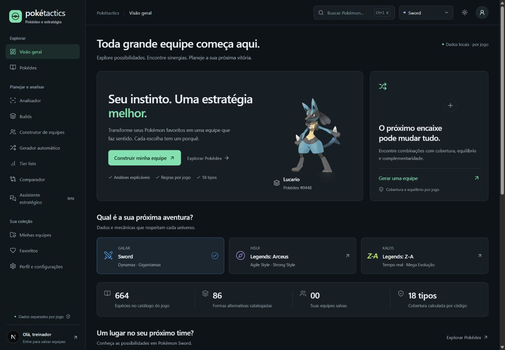
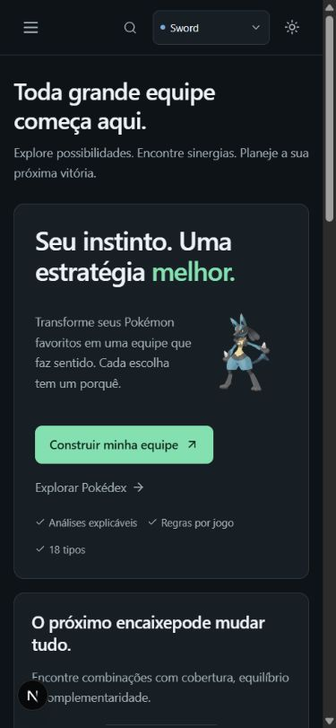
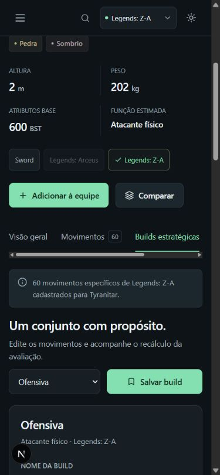

<div align="center">

# Pokétactics

### Conheça seu Pokémon. Encontre sinergias. Planeje sua próxima jogada.

Uma Pokédex estratégica para explorar possibilidades, criar builds e montar equipes com critérios que você consegue entender.

[](package.json)
[](tsconfig.json)
[](prisma/schema.prisma)
[](prisma/schema.prisma)
[](LICENSE)

**Sword / Shield · Legends: Arceus · Legends: Z-A**

[Recursos](#o-que-você-pode-fazer) · [Instalação](#rodando-na-sua-máquina) · [Branches](#organização-das-branches) · [Documentação](#por-dentro-do-projeto)

</div>



## Sua próxima equipe começa com uma boa escolha

O Pokétactics reúne catálogo, movimentos, builds e composição de equipes em um só lugar. Escolha o jogo, explore o potencial de cada Pokémon e veja como suas escolhas mudam a cobertura ofensiva e defensiva do time.

A análise principal é **determinística e explicável**: usa regras e dados próprios de cada jogo. Não exige chave de IA. A interface é em português brasileiro, com nomes de Pokémon, movimentos, habilidades e itens em inglês.

> **Estado do projeto:** núcleo full-stack funcional, em evolução. A tela **Fontes** mostra procedência, cobertura e lacunas. Os índices são heurísticas de planejamento; não representam probabilidade de vitória nem uma simulação completa de batalha.

## O que você pode fazer

| Ferramenta                 | Para que serve                                                                                                     |
| -------------------------- | ------------------------------------------------------------------------------------------------------------------ |
| **Pokédex**                | Buscar por nome, combinar filtros de tipos, geração e formas, ordenar e consultar disponibilidade por jogo.        |
| **Ficha de Pokémon**       | Explorar atributos, radar, evolução geral, formas, fraquezas, resistências, imunidades e movimentos.               |
| **Builds e analisador**    | Gerar sugestões de quatro movimentos por estilo, entender a seleção, editar os slots e recalcular.                 |
| **Construtor de equipes**  | Montar até seis integrantes e conferir funções, cobertura, vulnerabilidades compartilhadas e índice de composição. |
| **Gerador automático**     | Explorar combinações por beam search com Pokémon obrigatórios/proibidos, estilo, DLC e restrições de progresso.    |
| **Comparador**             | Colocar dois Pokémon lado a lado e comparar atributos e respostas defensivas.                                      |
| **Coleção pessoal**        | Salvar equipes e builds, favoritar Pokémon e manter preferências na sua conta.                                     |
| **Assistente estratégico** | Receber um relatório por templates a partir dos resultados do motor. Geração por LLM ainda desabilitada.           |
| **Fontes e critérios**     | Conferir a origem dos dados, a cobertura por jogo e o que ainda está pendente.                                     |

### Pensado também para o celular

Tema escuro em grafite e menta, opção de tema claro, navegação por teclado, foco visível, controles legíveis e layouts adaptados para desktop, tablet e celular.

<p align="center">
  
  &nbsp;
  
</p>

## Dados que respeitam cada jogo

O catálogo normalizado contém **1.025 espécies e 1.351 formas**. A disponibilidade de equipes e movimentos segue o jogo escolhido, incluindo as expansões catalogadas.

| Contexto                      | Espécies compatíveis | Formas disponíveis | Registros de learnset |
| ----------------------------- | -------------------: | -----------------: | --------------------: |
| Sword / Shield                |                  664 |                750 |                44.204 |
| Legends: Arceus               |                  242 |                261 |                 5.448 |
| Legends: Z-A / Mega Dimension |                  364 |                511 |                24.263 |

As **1.522 disponibilidades de formas nos três contextos** têm movimentos e geram builds no snapshot validado. Essa soma inclui uma mesma forma em mais de um jogo. Não significa que todos os Pokémon nacionais existam em todos os jogos.

Propriedades históricas, tipo, categoria e parâmetros de movimentos são tratados por jogo. Os downloads registram revisões e hashes; os importadores preservam a procedência dos dados. Veja [fontes e licenças](docs/FONTES.md) e [cobertura do snapshot](docs/COBERTURA_JOGOS.json).

## Rodando na sua máquina

### Requisitos

- Node.js **24+** e pnpm **11**, conforme o ambiente validado e o gerenciador utilizado.
- PostgreSQL **17**.
- Windows para o inicializador de banco incluído. Linux/macOS podem usar um PostgreSQL já configurado seguindo o [guia completo](docs/SETUP.md).

### Instalação do zero no Windows

Com Node.js, pnpm e PostgreSQL instalados:

```powershell
git clone https://github.com/pjz3650/pokedex-strategy-hub.git
cd pokedex-strategy-hub
pnpm install --frozen-lockfile
pnpm run db:local
pnpm run db:generate
pnpm run db:migrate
pnpm run data:download
pnpm run data:games
pnpm run db:import
pnpm run dev
```

Abra **[127.0.0.1:3000](http://127.0.0.1:3000)**. O primeiro download e a importação podem demorar. Crie sua conta pela interface para salvar equipes e favoritos; as consultas e análises são públicas.

O helper cria um cluster exclusivo em `.local/postgres`, escutando em `127.0.0.1:54329`, e gera `.env` com segredos aleatórios. Ele não configura o serviço PostgreSQL do sistema. Se os binários estiverem fora de `C:/Program Files/PostgreSQL/17/bin`, defina `PG_BIN`. Se já houver `.env` sem o cluster, siga a configuração manual do [guia](docs/SETUP.md).

### Já configurou o projeto?

```powershell
pnpm run db:local
pnpm run dev
```

No Windows, `iniciar.cmd` também inicia banco e aplicativo após a instalação. O wrapper `pnpm.cmd` usa o runtime local previamente instalado, quando disponível, ou o pnpm do `PATH`. Você pode executar os comandos como `.\pnpm.cmd run dev` no PowerShell.

Configuração manual de banco, atualização de dados, SMTP, troubleshooting e deploy estão em **[docs/SETUP.md](docs/SETUP.md)**.

## Organização das branches

A `main` reúne a aplicação completa. A importação inicial foi organizada por módulos, com commits próprios e merges preservados, seguindo o padrão do mp4-sync.

| Branch                      | Escopo                                                                 |
| --------------------------- | ---------------------------------------------------------------------- |
| `feature/data-pipeline`     | Schema, migrations, seed, snapshots, importação e curadorias por jogo. |
| `feature/strategy-engine`   | Regras, índices, legalidade, builds e serviços de composição.          |
| `feature/accounts-api`      | Autenticação, segurança, persistência pessoal e endpoints.             |
| `feature/pokedex`           | Catálogo, dashboard, ficha, navegação e infraestrutura da interface.   |
| `feature/team-builder`      | Construtor, geração, importação/exportação e equipes salvas.           |
| `feature/analysis-tools`    | Analisador, comparador, tiers, assistente e fontes.                    |
| `feature/modern-design`     | Refinamento visual, responsividade e acessibilidade.                   |
| `test/quality-suite`        | Testes de regras, dados, integração e navegador.                       |
| `docs/project-presentation` | README, guias, prévias e documentação de publicação.                   |

As branches registram etapas da organização inicial e têm dependências entre si; não são distribuições independentes. Use `main` para instalar e executar a versão integrada. Veja o [mapa de módulos](docs/BRANCHES.md).

## Por dentro do projeto

```text
src/
  app/           Rotas Next.js, API e estilos globais
  components/    Telas, navegação e componentes compartilhados
  lib/           Motor, repositório, contratos, validação e segurança
prisma/          Schema, migrations e seed
scripts/         Download, importação, auditoria e banco local
data/           Curadorias e manifesto das fontes
tests/          Regras, integração e testes de navegador
docs/           Arquitetura, critérios, cobertura e revisão visual
```

**Stack:** Next.js App Router · React 19 · TypeScript strict · PostgreSQL · Prisma · Auth.js · Zod · Recharts · Lucide · Vitest · Playwright.

- [Guia de instalação e operação](docs/SETUP.md)
- [Arquitetura](docs/ARQUITETURA.md)
- [Fórmulas e pesos do motor](docs/MOTOR.md)
- [Fontes, licenças e lacunas](docs/FONTES.md)
- [Auditoria do escopo](docs/AUDITORIA.md)
- [Sistema visual](DESIGN.md) e [revisão de interface](docs/DESIGN_REVIEW.md)

### Verificações

Com o banco de desenvolvimento iniciado e os dados importados:

```powershell
pnpm run typecheck
pnpm run lint
pnpm run test
pnpm run build
```

Para a suíte de navegador, sirva a aplicação na porta 3000 e execute `pnpm run test:e2e` em outro terminal. Ela utiliza Chrome, cria contas sintéticas e grava equipes/builds no banco configurado. Use um banco de desenvolvimento/teste. No Windows, pare o servidor antes de `pnpm run build`, pois a geração do Prisma pode encontrar a DLL em uso.

### Como contribuir

Crie uma branch `feature/nome-da-feature`, `fix/nome-da-correcao` ou `docs/nome-do-guia`. Mantenha os critérios do motor explicáveis, acrescente a procedência de novos dados e execute as verificações relevantes. Ao relatar problemas, inclua jogo, Pokémon e passos de reprodução, removendo dados pessoais dos logs.

## O que ainda está em evolução

- **Competitivo e rankings comunitários:** regulamentos, temporadas e fontes agregadas ainda não estão importados. As classes de atributos não são uma tier list comunitária.
- **Progresso de campanha:** encontros e etapas de obtenção têm cobertura parcial. Com a base atual, a geração estrita não encontra equipes porque etapas de movimentos são desconhecidas; há uma opção explícita para ignorar progresso.
- **Mecânicas específicas:** sem simulação completa de Agile/Strong, ordem de ações, alcance/frames, movimentos plus, transformações Mega, Dynamax ou Gigantamax. Formas Mega são consultáveis.
- **Atributos efetivos:** IVs, EVs e Effort Levels não são calculados; efeitos de itens não alteram o índice de movimentos.
- **Infraestrutura:** recuperação de senha exige SMTP; imagens dependem de rede; paginação das coleções pessoais e teste de carga seguem pendentes.

O detalhamento está na [auditoria](docs/AUDITORIA.md) e na tela `/fontes`. A integração com LLM não está implementada; adicionar uma chave não a habilita.

## Licença e créditos

O código do projeto segue a [licença MIT](LICENSE). Dados, imagens, marcas e dependências mantêm seus próprios direitos e condições, descritos em [THIRD_PARTY_NOTICES.md](THIRD_PARTY_NOTICES.md).

Projeto de fãs, sem vínculo com Nintendo, Creatures, GAME FREAK ou The Pokémon Company. Pokémon e seus personagens pertencem aos respectivos titulares.
