# Auditoria heurística de UX e usabilidade — Pokétactics

30/10/2026 · checkout `e62ce15` · escopo documental, sem implementação · revisão do usuário pendente.

## 1. Resumo executivo

O núcleo de consulta e planejamento é utilizável e tem salvaguardas relevantes: dados separados por jogo, motor explicável, learnsets reais, validação de legalidade e limites honestos. O principal atrito está na continuidade do trabalho: perder rascunho ao consultar outro jogo, perder identidade da equipe após reload, iniciar “nova” equipe sobre a anterior e abandonar uma build para recriá-la no construtor. O gerador permite parâmetros visivelmente diferentes do resultado ainda acionável. Falhas de importação, sessão e fontes oferecem recuperação insuficiente.

Foram consolidados **20 problemas: 9 de severidade 3 e 11 de severidade 2**. Não há problema classificado como crítico (4), marginal (1) ou estético. São **10 P1 e 10 P2; nenhum P0/P3**. Isso não demonstra ausência de outros defeitos. Dezesseis registros têm reprodução de interface nesta rodada (incluindo cenários simulados claramente identificados); quatro são confirmados por código. Hipóteses separadas não entram nos totais.

As propostas foram aprovadas tecnicamente para compor o plano; **a aprovação do usuário e a implementação ainda não ocorreram**. Não houve pesquisa com usuários reais, medição de conversão, taxa de erro ou tempo de tarefa. Impacto e frequência são estimativas fundamentadas na estrutura dos fluxos.

## 2. Escopo analisado

Documentos lidos: README.md, AGENTS.md, DESIGN.md, PRODUCT.md, docs/ARQUITETURA.md, AUDITORIA.md, MOTOR.md, DESIGN_REVIEW.md, SETUP.md, FONTES.md, ACOMPANHAMENTO.md e a revisão Type Study. Registros antigos foram tratados como históricos, não como prova de teste atual. Exemplo: SETUP ainda descreve comparador de dois, enquanto o código atual aceita quatro; a implementação e esta rodada prevalecem no inventário.

Inspeção de `src/app` (catch-all, layout, loading/error/not-found, API hub e Auth.js), todos os componentes de tela e compartilhados, contratos, motor, games, validação, repository, team-service, security, auth, schema/migrations e suítes de teste. Importação de dados e scripts operacionais foram lidos para entender ambiente/procedência, sem reimportar ou migrar dados.

## 3. Metodologia

Avaliação pelas dez heurísticas (H1–H10), decomposição de tarefas para iniciante/intermediário/avançado/recorrente e inspeção estática causal, combinadas com navegação local. Não foi necessário inventar problemas para preencher heurísticas. O exemplo solicitado de autocomplete foi investigado: o picker já filtra durante a digitação; o atrito comprovado é a seleção em outro controle, não a necessidade de submeter a busca.

Evidências têm três categorias exclusivas por conclusão: **Confirmado por teste**, **Confirmado por código** e **Hipótese a validar**. Um cenário com resposta de API simulada confirma a reação da UI àquela resposta, não autenticação ou persistência reais. Captura ilustra o estado; passos e implementação explicam a causa. Propostas são decisões de design a validar futuramente, não resultados de pesquisa com usuários.

Severidade: 0 adequado, 1 marginal, 2 menor, 3 maior, 4 crítico. Prioridade: P0 bloqueio crítico, P1 alto impacto nas tarefas centrais, P2 eficiência/clareza relevante, P3 secundário. Complexidade relativa: P pequena/local, M média/vários componentes, G grande/estado compartilhado; não são estimativas de prazo.

## 4. Ambiente e limitações da avaliação

Windows/PowerShell, Node 24.19.0, Next 16.4.2, React 19, Prisma 6.19.3 e PostgreSQL local exclusivo do projeto em loopback:54329. A aplicação já estava servindo em 127.0.0.1:3000; iniciar outra instância retornou EADDRINUSE, e a existente foi reutilizada. O arquivo .next/BUILD_ID foi gerado em 30/10 e os comportamentos foram confrontados com o checkout; a data do build sozinha não prova identidade de código. Não foi feito novo build nem parado serviço preexistente. A primeira tentativa no sandbox não enxergou o banco; a execução autorizada do helper confirmou banco já em execução.

Health real confirmou engine 1.1.0, generativeAI=false e cobertura abaixo. Nenhuma chave foi lida/divulgada. Não houve migrations, importação, modificação de código ou DESIGN.md, publicação, criação de conta ou alteração de registros pessoais. Chamadas de análise/geração atualizam contadores operacionais de rate limiting já existentes. Rascunhos ficaram em contextos de navegador descartáveis. As fixtures de /me existiram só na interceptação Playwright.

| Jogo                 | Espécies | Formas com disponibilidade e movimentos | Learnsets | Propriedades verificadas |
| -------------------- | -------: | --------------------------------------: | --------: | -----------------------: |
| Sword                |      664 |                                     750 |    44.204 |                      637 |
| Arceus               |      242 |                                     261 |     5.448 |                      177 |
| Z-A / Mega Dimension |      364 |                                     511 |    24.263 |                      340 |

O total de 1.522 disponibilidades não é total de formas únicas. Progresso de movimentos é desconhecido: compatibilidade no jogo não prova obtenção numa etapa.

Executado nesta rodada:

- Navegação inicial no navegador integrado e automação Playwright/Chrome headless, conforme a preferência do pedido; 15 destinos × 3 viewports (1440×1000, 768×1024 e 390×844): **45 verificações de abertura/reflow**. Nenhuma excedeu a largura do documento. Isso cobre estados iniciais de visitante; não são 45 jornadas completas nem certificação de responsividade.
- Casos dirigidos de pesquisa, retorno, seleção, rascunho, reload, jogo, movimentos, build→time, geração estrita e com opt-in, alteração de critérios, três comparados, menu mobile, teclado em abas/busca, erro de importação e assistente. Respostas 503/abort simuladas para health/me/assistant; conta/equipe e preferências de /me simuladas.
- Vitest: **75/75 em cinco arquivos**, via `node node_modules/vitest/vitest.mjs run tests/engine.test.ts tests/game-move-properties.test.ts tests/learnset-import.test.ts tests/pokemon-visual.test.ts tests/source.test.ts` (6,53 s). São regras/parsers/metadados/fontes, não testes de UX. source.test usa respostas simuladas, sem scrape novo.

Não executado: suíte PostgreSQL de integração, E2E autenticado de CRUD, entrega SMTP/reset, carga, leitor de tela NVDA/JAWS/VoiceOver, Safari/Firefox/iOS físico, toque em hardware, todos os temas em todos os estados, falha real do banco, base inteiramente vazia e navegação completa das 1.351 formas. Build/lint/typecheck não foram refeitos porque não houve mudança funcional; resultados antigos não foram somados aos 75 atuais. Emulação de largura não equivale a touchscreen: toque deve ser validado na implementação.

A revisão automática de segurança rejeitou um roteiro que submetia recuperação de senha, pelo risco de envio de e-mail/efeitos de conta. Essa etapa foi retirada e não foi contornada. Recuperação permaneceu inspeção de código/formulário; enviar instruções e redefinir senha exigem rodada específica autorizada em ambiente de teste com caixa SMTP isolada. Nenhum bloqueio impede revisar os três documentos.

Os scripts e JSONs transitórios da auditoria foram removidos ao finalizar; capturas aceitas e medições relevantes estão neste relatório. A rotina temporária precisou corrigir seletores ambíguos (anunciador role=alert do Next e transições de rota). Leituras feitas antes da estabilização não foram aceitas: por exemplo, a transferência de build só foi confirmada após campo vazio e sessionStorage concordarem. Capturas com animação de menu ou rolagem em trânsito foram descartadas.

## 5. Inventário de telas e funcionalidades

| Rota/superfície      | Implementação existente                                                                                                                       | Limites/incompleto/planejado                                                                                          |
| -------------------- | --------------------------------------------------------------------------------------------------------------------------------------------- | --------------------------------------------------------------------------------------------------------------------- |
| /                    | Jogos, números do catálogo, destaques, última equipe do jogo, histórico opt-in                                                                | Resumo defensivo usa tipos, não movimentos/habilidades; sem inventar resultado de batalha                             |
| /pokedex             | Pesquisa local por nome/número, tipos, secundário, geração, forma, evolução, disponibilidade, sort, 36 cards/página, limpar                   | Contexto local não codificado na URL; só disponibilidades verificadas entram no catálogo                              |
| /pokemon/:id         | Hero, jogo, adicionar, comparar; abas overview/moves/builds/availability                                                                      | Transformações consultáveis, configuração de batalha pendente                                                         |
| Visão geral da ficha | Atributos, radar, foco de movimentos, habilidades, defesa; prévia Mega Z-A com atributos e defesa expansível                                  | Base stats não são efetivos; prévia não concede Mega ao time                                                          |
| Movimentos           | Busca, tipo/categoria/método/ordem, paginação incremental, parâmetros e fonte                                                                 | Sem simulação de estilos Arceus/plus Z-A; NULL permanece desconhecido                                                 |
| Formas e obtenção    | Formas, links entre jogos, aquisição, fontes, encontros, relações evolutivas                                                                  | Métodos e condições por jogo incompletos; sem inferir disponibilidade pela espécie                                    |
| /analisador, /builds | Mesmo Analyzer/BuildWorkbench: estilo, quatro movimentos, habilidade/item/nature, sugestões, alternativas, índices, CRUD de builds em /builds | Recursos não equivalem a cálculo EV/IV/Effort; itens não mudam índice de golpes; sem transferência direta da build    |
| /equipes             | Seis slots, foco para adicionar, edição, sugestão, nome, salvar/atualizar, import/export JSON, análise debounced e matriz                     | Sem substituir/reordenar; duplicatas manuais não são proibidas pelo domínio atual; rascunho não é salvamento na conta |
| /gerador             | Estilo, etapa, tamanho, DLC, opt-in de progresso, required/banned, variante, avisos, análise, abrir no construtor                             | Estrito falha no snapshot por etapas desconhecidas; beam search não garante ótimo global                              |
| /comparador          | Dois a quatro, seletores excluem IDs já escolhidos, remoção, atributos, radar e defesa, link para ficha                                       | Radar só dos dois primeiros explicitamente; sem vencedor universal/builds/transformação configurada                   |
| /tiers               | Estimativa de atributos, filtro tipo/etapa, incluir transformações, 36 por classe, fórmula; aba comunitária e links                           | Sem duas fontes compatíveis importadas; agregado comunitário não implementado                                         |
| /assistente          | Relatório por template, anotação, mensagens, histórico opt-in                                                                                 | LLM/perguntas livres não implementados e avisados; chave não habilita IA                                              |
| /minhas-equipes      | Listar, consultar integrantes, abrir no construtor, nova equipe, excluir                                                                      | Paginação de coleções grandes pendente, sem evidência atual de lentidão                                               |
| /favoritos           | Mesmos filtros/cards do catálogo, favorito por forma                                                                                          | Persistência requer conta; estado de sessão ainda mistura falha/visitante                                             |
| /perfil              | Entrar/cadastrar, mostrar senha, recuperar/reset por token; conta, logout, nome, jogo principal, etapa por jogo, tema, opt-in de histórico    | SMTP condicionado; apagar histórico ao desativar é explicado no controle                                              |
| /fontes              | Saúde, cobertura, fontes/licenças, critérios e lacunas                                                                                        | Consultas sem recuperação independente                                                                                |
| Shell                | Sidebar ativa, breadcrumbs, menu mobile com foco/scroll/Escape, tema, troca de jogo, busca global Ctrl/Cmd+K e diálogo                        | Busca global limita oito; sem seta/Enter no input, mas links/botões alcançáveis por Tab                               |
| Compartilhados       | Toast role=status; Notice, EmptyState, fallback de arte/sprite, loading, error com retry, 404 com rota de retorno                             | Não foi feito audit visual/contraste novo, nem conformidade global de leitor de tela                                  |

APIs investigadas: GET catalog, pokemon/:id?game, sources, health, me; POST register/recover/reset/analyze/build-evaluate/generate/assistant/history; PATCH me; POST/DELETE favorites/:formId; POST/PATCH/DELETE teams e builds; Auth.js GET/POST em /api/auth/[...nextauth]. Zod valida entradas; serviço verifica movimentos, formas, habilidades e itens; ownership é derivado da sessão. POST analyze é público e aceita time vazio para análise, diferente do teamSchema de salvamento (mínimo um): importação precisa considerar o propósito. O catálogo público tem cache interno, APIs respondem no-store; nenhum dado privado deve ser colocado no cache público.

## 6. Matriz de cobertura da auditoria

Legenda: T teste real de interface; S teste com resposta simulada; C código; — não executado.

| Área                    | Inicial D/T/M | Sucesso                                   | Vazio/indisponível         | Erro/rede               | Teclado                 | Persistência real               |
| ----------------------- | ------------- | ----------------------------------------- | -------------------------- | ----------------------- | ----------------------- | ------------------------------- |
| Dashboard               | T/T/T         | T                                         | T visitante                | C                       | C                       | —                               |
| Pokédex/favoritos       | T/T/T         | T parcial/caixa                           | T filtros/visitante        | S /me                   | C                       | —                               |
| Ficha/formas/evolução   | T/T/T         | T Lucario + C relações/prévia Mega        | C disponibilidade          | C                       | T abas/setas            | —                               |
| Builds/analisador       | T/T/T         | T sugestão/transferência                  | T temporária + C           | C                       | C selects               | —                               |
| Construtor              | T/T/T         | T slots/sugestão/análise                  | T vazio/limite por C       | T parser + C legalidade | T modal/menu; C selects | T sessionStorage; conta —       |
| Gerador                 | T/T/T         | T Z-A opt-in                              | T estrito; C contraditório | T 400                   | C                       | Não aplicável até transferência |
| Comparador              | T/T/T         | T três e troca jogos; C quatro/remover    | C pool                     | C                       | C                       | Estado local C                  |
| Tiers                   | T/T/T         | T abertura; C filtros                     | C comunidade               | C                       | C                       | Não aplicável                   |
| Assistente              | T/T/T         | T template                                | T contexto trocado         | S abort                 | C                       | Histórico opt-in C              |
| Equipes salvas          | T/T/T         | S abrir/nova                              | T visitante                | C DELETE                | C                       | —                               |
| Perfil                  | T/T/T         | S preferências carregadas; C autenticação | T visitante                | C formulário/SMTP       | C sem leitor            | —                               |
| Fontes                  | T/T/T         | T saúde/cobertura                         | C                          | S health503             | C tabela                | Não aplicável                   |
| Shell/404/loading/error | T/T/T         | T menu/Escape/busca e 404                 | T sem busca                | C fronteira de erro     | T abas/global/menu      | Tema C; IAB observado escuro    |

D=desktop, T no cabeçalho de dispositivo=tablet, M=mobile. Não confundir T de teste com tablet. Abertura em cada largura só verifica acesso/reflow, não todos os estados secundários.

## 7. Avaliação das dez heurísticas

| Heurística            | Comportamento correto a preservar                                                      | Atritos rastreáveis                                                                                               |
| --------------------- | -------------------------------------------------------------------------------------- | ----------------------------------------------------------------------------------------------------------------- |
| H1 Estado visível     | Botão pendente de salvar/gerar, recalculando, loading e toast                          | UX-02, UX-10, UX-12, UX-18, UX-19, UX-20                                                                          |
| H2 Mundo real         | PT-BR, tipos nomeados, jogo explícito, campanha distinguida de competitivo             | UX-03, UX-08, UX-14, UX-17                                                                                        |
| H3 Controle/liberdade | Escape em diálogos/menu; import/export; edição manual                                  | UX-01 a UX-05, UX-09, UX-11, UX-20                                                                                |
| H4 Consistência       | Reuso de picker/editor, regras por jogo, comparação sem vencedor fictício              | UX-02, UX-04, UX-06 a UX-08, UX-12, UX-15                                                                         |
| H5 Prevenção          | Zod, legalidade no servidor, exclusões do comparador, movimentos duplicados bloqueados | UX-01, UX-03, UX-05, UX-07, UX-11 a UX-13                                                                         |
| H6 Reconhecimento     | Tipos/IDs/nomes de forma; fontes e alternativas visíveis                               | UX-06, UX-15, UX-16                                                                                               |
| H7 Eficiência         | Filtros dinâmicos, sugestões, geração→construtor existente, Ctrl/Cmd+K                 | UX-04, UX-06, UX-09, UX-16                                                                                        |
| H8 Economia cognitiva | Áreas de dados estruturadas; limites e componentes do índice acessíveis                | Sem defeito isolado adicional; duplicação de seleção UX-06 é tratada como eficiência, sem propor redução estética |
| H9 Recuperação        | Servidor distingue erro de validação/insuficiência; fronteira global tem retry         | UX-06, UX-10, UX-13, UX-14, UX-17 a UX-20                                                                         |
| H10 Ajuda             | /fontes e explicações, natureza heurística e limites de dados explícitos               | UX-14 contextualiza a ajuda no momento da falha; não se justifica onboarding novo sem pesquisa                    |

Referência funcional de acessibilidade: [WCAG 2.2](https://www.w3.org/TR/WCAG22/) e [padrão combobox WAI-ARIA](https://www.w3.org/WAI/ARIA/apg/patterns/combobox/). Priorizar teclado (2.1.1/2.1.2), foco lógico/restaurado (2.4.3/2.4.11), identificação/sugestão de erro (3.3.1/3.3.3), nomes/estados (4.1.2) e anúncios (4.1.3). A relação do erro da importação com modal top layer é demonstrada; conformidade com leitor de tela requer teste específico. A falta de setas na busca global atual é oportunidade de eficiência, não prova isolada de violação WCAG: Tab e Enter nos botões já funcionam. Não atribuir pontuação de acessibilidade global a screenshots.

## 8. Análise por funcionalidade

Busca: a Pokédex já responde a cada tecla e ignora caixa; o picker reduz o select dinamicamente. Uma consulta “Luc” retornou Lucario e Hawlucha por substring; isso é coerente com nome parcial, não resultado errado. Espaços colados falham. Formas possuem nome distinto e ID por forma, número nacional por espécie. Não foi validado um dicionário de aliases/acentos para todas as espécies; normalização proposta não autoriza traduções/aliases inventados. A seleção direta beneficia composição repetida; catálogo com cards não precisa de um autocomplete que duplique toda a lista.

Equipes: há seis slots acionáveis, edição contextual e análise automática por requisição debounced de 300 ms com descarte de resposta por efeito. A adição manual começa sem golpes e o botão de sugestão preenche quatro quando existem; isso é escolha legítima. O problema é a transferência de uma build já escolhida, não ausência universal de padrão útil. Remoção, substituição, identidade e retomada demandam UX-01–04/08–11. Reordenação não foi proposta sem requisito de posição inicial/ordem de batalha no motor atual.

Builds/movimentos: learnsets, método e tipo são por jogo; duplicação de golpe é desabilitada. Itens curados têm efeito/local/fonte; habilidade só onde aplicável. Natures podem ser salvas sem cálculo efetivo, conforme limite. Preservar isso. As alternativas legais são informativas: não basta torná-las botão sem escolher qual slot substituir. A bancada deve preservar a edição enquanto o usuário investiga o learnset (UX-05).

Gerador: separa proibidos/obrigatórios na UI, preserva determinismo e transfere golpes para o construtor. Não ativar opt-in automaticamente nem “consertar” a ausência de etapas inventando dados. UX-12–15 tratam associação de resultado, contradições, diagnóstico e precedência de preferências. Não ampliar beam search ou simular vitória como melhoria de UX.

Comparador: já aceita até quatro, impede IDs repetidos nos seletores, adapta-se ao jogo, compara base stats/defesa e explica que radar cobre dois. Teste com três passou. Ao trocar de jogo, formas sem disponibilidade saem e o mínimo de dois é recomposto; essa decisão existe e pode surpreender, mas falta evidência suficiente de prejuízo para um item obrigatório novo. Ver HYP-02 antes de prometer persistência de comparações. As melhorias compartilhadas de picker e retorno já o beneficiam.

Coleções/conta: favoritos têm ação independente do link do card e bloqueio inicial durante consulta pessoal; não há justificativa para novo sistema de coleções. UX-11 protege exclusões; UX-18 evita falso logout. Backend de sessão/ownership é real no código e coberto por testes existentes históricos, porém não reexecutado autenticado nesta rodada. Não confundir fixtures UI com prova de autorização. Perfil já recupera a etapa do jogo principal ao selecioná-lo; o defeito é no gerador, não atribuir esse defeito também ao formulário de perfil.

Assistente: a interface já diz que não interpreta perguntas livres e chama o input de anotação. Não reportar “IA ausente” como defeito. UX-20 trata contexto e retry; não exige LLM. Tiers: fórmula, recorte e limite de 36 estão explícitos; ausência comunitária é honesta. Fontes: material de confiança completo, mas estado de erro contraditório em UX-19. Dashboard: resumo do time é útil e apresenta o limite de tipagem; não promover cálculo de habilidades completo a partir desse cartão.

## 9. Jornadas entre funcionalidades

O detalhamento está em [UX_USER_JOURNEYS.md](UX_USER_JOURNEYS.md); a especificação executável repete as decisões, sem depender desta conversa.

| Jornada                                             | Quebra atual                                                          | Direção aprovada tecnicamente                                                                 |
| --------------------------------------------------- | --------------------------------------------------------------------- | --------------------------------------------------------------------------------------------- |
| J1 Buscar → ficha → build → time → salvar           | Filtros perdidos, build não transferida, edição local descartada      | UX-04/05/06/16; Member único e retorno com recorte                                            |
| J2 Jogo → disponíveis → time → cobertura            | Trocar jogo destrói rascunho; temporária oferecida como integrante    | UX-01/02/07; contexto e elegibilidade por intenção                                            |
| J3 Gerar → entender → substituir → salvar           | Estrito pouco diagnosticável, resultado obsoleto, troca destrutiva    | UX-09/12/13/14/15                                                                             |
| J4 Fraquezas → alternativas → comparar → escolher   | Troca entre ferramentas exige refazer seleção e remover membro cedo   | UX-06/09/16, sem motor de recomendação novo                                                   |
| J5 Abrir salva → editar → recalcular → atualizar    | Identidade desaparece no reload; nova equipe reusa identidade antiga  | UX-02/03/11/18                                                                                |
| J6 Ficha → voltar → continuar catálogo/favoritos    | Link fixo /pokedex e filtros locais                                   | UX-16/17                                                                                      |
| J7 Trocar jogo → entender efeitos → retomar         | Limpa time e pode manter etapa do gerador anterior                    | UX-01/12/15                                                                                   |
| J8 Importar → corrigir → validar → salvar           | Erro fora do diálogo; rascunho pode ser substituído                   | UX-10/02/18                                                                                   |
| J9 Favoritar → entrar → retomar → recuperar coleção | 503 aparenta visitante; retorno pós-login depende de navegação manual | UX-18; retorno pós-login contextual é hipótese a medir, não funcionalidade adicional aprovada |
| J10 Analisar → mudar contexto → repetir após falha  | Relatório anterior sem cabeçalho de origem; anotação perdida          | UX-20                                                                                         |

Não houve cronometragem. Contagens de ações nos mapas são decomposição do fluxo atual e metas estruturais de projeto, não redução percentual medida com usuários.

## 10. Problemas identificados e evidências

Cada registro abaixo inclui consequência, reprodução, causa, decisão e aceitação. As capturas são desta rodada; simulações estão identificadas no texto. Linhas referem-se ao checkout e podem mudar na implementação.

### UX-01 — Trocar de jogo apaga o rascunho sem recuperação

**Área:** Jogo global, ficha, perfil e construtor. **Heurísticas:** H3, H5. **Severidade:** 3. **Prioridade:** P1.

**Evidência:** Confirmado por teste — Sword com Lucario configurado → Arceus → Sword: zero slots preenchidos. Confirmado também em código.

**Código:** [src/components/providers.tsx](../../src/components/providers.tsx):114–126 (`setGame`, `setDraft`); [src/components/pokemon-detail.tsx](../../src/components/pokemon-detail.tsx):78–84 e 447–449; [src/components/account-page.tsx](../../src/components/account-page.tsx):103.

**Reprodução:** Em /equipes, selecione Lucario, sugira movimentos e altere o jogo no cabeçalho para Arceus. Volte a Sword.

**Atual:** `setGame` executa `setDraftState([])`, remove `hub-draft` e zera `editTeamId`. Links para formas de outro jogo e salvar jogo principal também chegam a essa função.

**Impacto:** Um usuário recorrente perde trabalho mesmo quando só pretendia consultar outro jogo; formas relacionadas podem causar a mesma perda indiretamente.

**Esperado/proposta:** Manter um rascunho independente para cada jogo na mesma sessão. Trocar o contexto deve restaurar o rascunho daquele jogo, sem converter integrantes ou movimentos.

**Decisão concreta:** Centralize rascunhos por GameId no provider. Antes de mudar o jogo, guarde o envelope atual; ao entrar no destino, restaure apenas o envelope desse jogo. Faça ações de ficha, dashboard, perfil e equipe salva usar a mesma transição. Mostrar status “Rascunho de Sword preservado nesta sessão” quando existir trabalho. Não perguntar a cada troca se a preservação torna a ação reversível.

**Dependências:** UX-02 define o envelope. Aplicar esta base antes de UX-03, UX-04 e UX-09.

**Casos extremos:** Primeira visita a outro jogo; link de forma regional; URL com game; abrir equipe salva; usuário deslogado; armazenamento indisponível; duas equipes no mesmo jogo.

**Efeitos colaterais:** A restauração pode contrariar links que hoje limpam o time. Separe mudança de contexto de criação/substituição intencional; revalidar dados restaurados.

**Aceitação:**

- Sword → Arceus → Sword restaura mesmos membros, movimentos, nome e origem de edição.
- Nenhum movimento/habilidade/item atravessa a fronteira de jogos por conversão implícita.
- Abrir outra equipe no mesmo jogo resolve substituição de rascunho explicitamente, sem sobrescrever o trabalho anterior silenciosamente.

**Validação:** Unitário do redutor/transição por jogo; integração de restauração; E2E via cabeçalho, link de forma e salvar preferências. Verificar os três jogos.

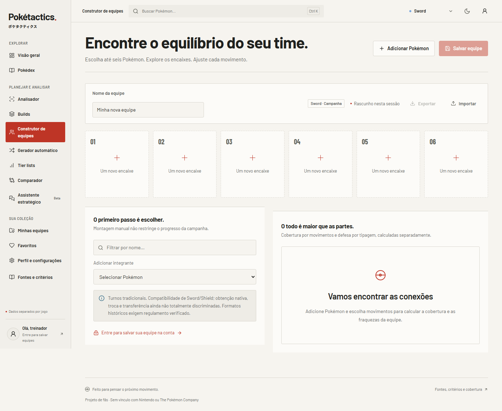

### UX-02 — O rascunho preserva integrantes, mas perde nome e identidade de edição

**Área:** Construtor e retomada. **Heurísticas:** H1, H3, H4. **Severidade:** 3. **Prioridade:** P1.

**Evidência:** Confirmado por teste — após reload, um integrante reaparece, mas o nome vira “Minha nova equipe”. Com /me simulado, uma equipe aberta passa de “Atualizar equipe” para “Salvar equipe” após reload. CRUD real não executado.

**Código:** [src/components/providers.tsx](../../src/components/providers.tsx):75, 102–108, 124–126; [src/components/team-pages.tsx](../../src/components/team-pages.tsx):160, 169–174, 225–229.

**Reprodução:** Nomeie um rascunho e recarregue /equipes. Para edição, abra equipe salva e recarregue antes de salvar.

**Atual:** sessionStorage recebe somente `{game,members}`; nome é estado local e editTeamId existe só em memória. O efeito dependente de `personal` também pode reatribuir o nome durante refresh.

**Impacto:** O usuário pode criar uma cópia involuntária, perder o título e acreditar que está atualizando o registro original.

**Esperado/proposta:** Um envelope versionado de rascunho com identidade, nome e alterações pendentes, recuperável na sessão e separado por conta/jogo.

**Decisão concreta:** Persistir versão, gameId, name, members, editTeamId opcional e estado alterado; manter baseline para comparar salvamento. Migrar o formato legado sem perder members. Restaurar editTeamId apenas depois de confirmar que a equipe pertence à conta atual; se não existir, manter conteúdo como cópia local e explicar. Atualizar nome a partir da conta somente ao abrir explicitamente o registro, nunca a cada refresh.

**Dependências:** Fundação de UX-01; contratos de Personal e SavedTeam; validação do envelope no cliente.

**Casos extremos:** JSON de sessão corrompido; conta diferente; equipe removida; visitante que faz login; logout; preferência alterada; storage bloqueado.

**Efeitos colaterais:** Guardar um ID sem conferir propriedade cria confusão entre contas. Não armazenar credenciais ou usar o ID como autorização.

**Aceitação:**

- Reload preserva nome, integrantes e intenção de atualizar a mesma equipe válida.
- Falha em storage informa que o rascunho está apenas na memória e não impede editar.
- Logout remove vínculo pessoal e não expõe rascunho privado à próxima conta.
- Refresh da coleção não substitui um nome digitado e ainda não salvo.

**Validação:** Unitários de migração, validação e dirty state; integração com /me atrasado/401/503; E2E criar rascunho, reload, login e editar registro existente em banco de teste.

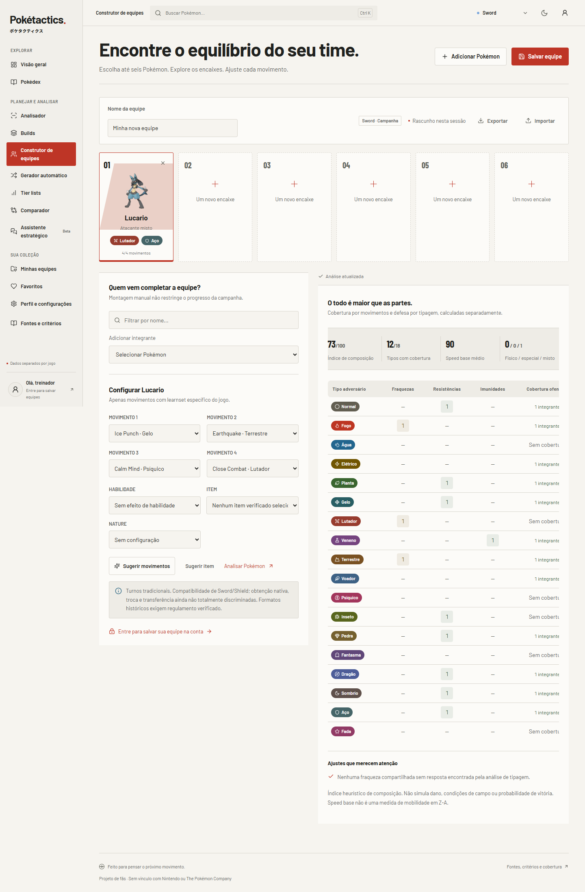

### UX-03 — “Nova equipe” reabre a equipe em edição

**Área:** Minhas equipes → construtor. **Heurísticas:** H2, H3, H5. **Severidade:** 3. **Prioridade:** P1.

**Evidência:** Confirmado por teste com /me simulado — abrir “Equipe simulada”, voltar à coleção e acionar “Nova equipe” mantém “Atualizar equipe” e o nome antigo. Sem gravação no servidor.

**Código:** [src/components/team-pages.tsx](../../src/components/team-pages.tsx):729–739 (Link de Nova equipe), 217–229 e 791–798.

**Reprodução:** Abra uma equipe da coleção no construtor, volte a /minhas-equipes e clique Nova equipe.

**Atual:** O link navega para /equipes sem zerar editTeamId ou criar um novo envelope. A próxima gravação usa PATCH da equipe anterior.

**Impacto:** O rótulo de criação induz o usuário a modificar uma equipe existente; há risco de sobrescrita por engano.

**Esperado/proposta:** Separar “continuar rascunho”, “editar equipe” e “nova equipe”. Nova equipe cria identidade local nova com destino POST.

**Decisão concreta:** Crie ação explícita startNewTeam(game). Se o rascunho corrente estiver alterado, oferecer “Continuar editando”, “Exportar rascunho” ou “Descartar e criar nova”; cancelamento mantém tudo. Sem alterações pendentes, iniciar vazio diretamente. Limpar ID e baseline, restaurar nome padrão e foco no primeiro seletor. A navegação normal para o construtor continua retomando o rascunho.

**Dependências:** UX-01 e UX-02.

**Casos extremos:** Equipe recém-salva; rascunho vazio; salvar falhou; visitante; voltar do comparador; equipe original de outro jogo.

**Efeitos colaterais:** Limpar incondicionalmente criaria uma nova perda de trabalho; oferecer decisão somente quando houver conteúdo pendente.

**Aceitação:**

- Nova equipe nunca mantém ID da equipe anterior.
- Cancelar mantém nome, membros e estado anterior.
- Salvar a nova equipe faz POST; atualizar uma equipe aberta continua usando PATCH.

**Validação:** Integração das ações do provider; E2E com duas equipes sintéticas e assertiva de método/ID, sem tocar registros reais.

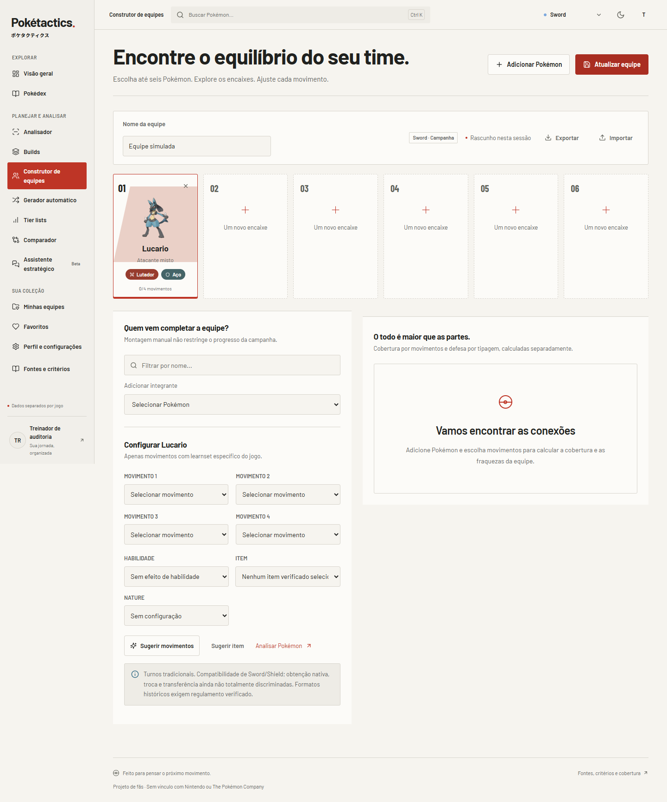

### UX-04 — A passagem da build para a equipe perde a configuração

**Área:** Ficha/builds → construtor. **Heurísticas:** H3, H4, H7. **Severidade:** 3. **Prioridade:** P1.

**Evidência:** Confirmado por teste — Lucario em Sword na aba Builds tinha IDs [8,89,347,370]; depois de “Adicionar à equipe”, o membro no rascunho tinha `moves:[]` e os quatro campos vazios.

**Código:** [src/components/pokemon-detail.tsx](../../src/components/pokemon-detail.tsx):117–133, 900–995; [src/components/team-pages.tsx](../../src/components/team-pages.tsx):518–522. BuildWorkbench não oferece ação de transferência.

**Reprodução:** Abra /pokemon/448?game=sword, acesse Builds estratégicas, configure a build, clique Adicionar à equipe e abra o construtor.

**Atual:** A ação do hero adiciona somente formId e movimentos vazios. Builds salvas também não têm ação direta para uso no time; o gerador já transfere movimentos corretamente.

**Impacto:** O usuário repete quatro escolhas e configurações, podendo inserir uma build diferente da que acabou de avaliar.

**Esperado/proposta:** Oferecer “Adicionar esta build à equipe” na bancada, usando o Member exibido. O hero pode continuar adicionando apenas a espécie, deixando isso explícito.

**Decisão concreta:** Adicionar ação contextual ao BuildWorkbench com o membro completo: formId, moves na ordem, itemId, abilityId e nature. Revalidar jogo e forma permanente. Se o time tiver seis, abrir escolha de slot para substituir com confirmação contextual e cancelamento. Não sobrescrever build existente de mesmo Pokémon sem escolha. Oferecer “Abrir construtor” após sucesso. Reutilizar a ação ao abrir build salva.

**Dependências:** UX-01, UX-02, UX-07, UX-09 e correção UX-08 da ordem dos campos.

**Casos extremos:** Equipe cheia; mesma forma em mais de um slot manual; forma temporária analisável; um a três movimentos naturais; conta ausente; jogo diferente.

**Efeitos colaterais:** Não reaproveitar movimentos entre jogos nem aplicar transformações ainda sem configuração; duplicação manual não deve ser proibida por regra inventada.

**Aceitação:**

- O integrante recebe exatamente os campos visíveis na bancada, sem inventar movimentos.
- Cancelar substituição não altera o time nem a build.
- Forma temporária permanece consultável, mas não é adicionada como membro permanente.
- Visitante consegue transferir ao rascunho; salvar na conta continua exigindo autenticação.

**Validação:** Integração do payload Member; E2E com build manual, build salva, time cheio e três jogos. Comparar IDs e ordem, não só o nome do Pokémon.

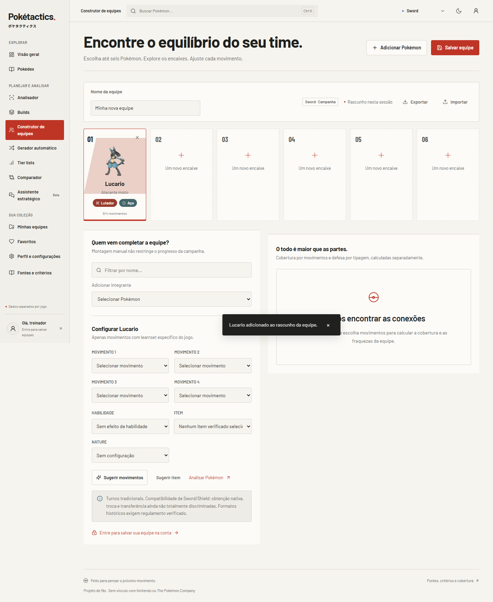

### UX-05 — A bancada descarta edição manual ao mudar estilo ou sair da aba

**Área:** Builds, analisador e ficha. **Heurísticas:** H3, H5. **Severidade:** 3. **Prioridade:** P1.

**Evidência:** Confirmado por código — `onChange` de estilo chama `setManual(null)`; BuildWorkbench é renderizado condicionalmente pela aba e recebe key por Pokémon/jogo/build. Não houve teste específico de todas as transições de desmontagem.

**Código:** [src/components/pokemon-detail.tsx](../../src/components/pokemon-detail.tsx):430, 900–918, 962–968; [src/components/tools-pages.tsx](../../src/components/tools-pages.tsx):73–80.

**Reprodução:** Edite movimentos/nome na bancada; escolha outro estilo. Na ficha, saia para Movimentos e retorne a Builds.

**Atual:** Trocar estilo substitui a configuração manual pela recomendação; sair do componente elimina estado local que não foi salvo. Não há aviso ou recuperação.

**Impacto:** Experimentação estratégica custa retrabalho e desestimula consultar o learnset durante a edição.

**Esperado/proposta:** Separar alterar o critério de avaliação de aplicar outra recomendação; conservar rascunho de build na sessão enquanto se consulta outra aba.

**Decisão concreta:** Manter rascunho por conta/jogo/formId/buildId ou chave local nova. Na mudança de estilo, recalcular a avaliação do conjunto manual atual; oferecer botão explícito “Aplicar sugestão deste estilo”. Antes de substituir movimentos editados, mostrar comparação simples e permitir cancelar. Aplicar sugestão altera só movimentos; não zerar item/habilidade/nature sem necessidade. Restaurar rascunho ao voltar e após reload.

**Dependências:** UX-02 como padrão de ciclo de vida, sem compartilhar indevidamente o envelope de equipe. UX-08.

**Casos extremos:** Conjunto automático ainda intacto pode acompanhar estilo automaticamente; edição manual parcial; mesma forma em jogos diferentes; build apagada; navegação entre analisador e builds.

**Efeitos colaterais:** Preservar a build não deve fazer a avaliação usar estilo ou jogo antigo; guardar a origem da sugestão e a do critério atual separadamente.

**Aceitação:**

- Mudar estilo depois de editar não descarta movimentos manuais.
- Aplicar sugestão explicitamente substitui os movimentos e permite cancelar antes de perder a edição.
- Sair da aba, consultar movimentos e voltar conserva nome/configuração não salva.

**Validação:** Unitários das transições auto/manual; integração desmontar/remontar; E2E alternar abas/estilos e voltar de ficha completa.

### UX-06 — O seletor exige filtrar e depois abrir outro controle

**Área:** Seleção compartilhada e busca global. **Heurísticas:** H4, H6, H7, H9. **Severidade:** 2. **Prioridade:** P2.

**Evidência:** Confirmado por teste e código — “Luc” filtra a lista do select para Lucario e Hawlucha, mas exige abri-lo; “ Lucario ” retorna zero na Pokédex e busca global. Na busca global, seta/Enter no input mantiveram o diálogo aberto; Tab continua disponível.

**Código:** [src/components/pokemon-detail.tsx](../../src/components/pokemon-detail.tsx):1090–1139; [src/components/dashboard-catalog.tsx](../../src/components/dashboard-catalog.tsx):424–433; [src/components/shell.tsx](../../src/components/shell.tsx):113–128 e 308–351.

**Reprodução:** No construtor, digite Luc em Filtrar Adicionar integrante e selecione no campo abaixo. Procure nome com espaços nas extremidades. Na busca global, tente seta abaixo/Enter.

**Atual:** Há atualização durante a digitação, sem necessidade de confirmar pesquisa. Entretanto a escolha fica num select separado, sem lista dinâmica selecionável no mesmo campo; o picker não busca por número nem explica lista vazia. `toLowerCase()` não remove espaços/acentos.

**Impacto:** A tarefa repetida de seleção exige mudança de controle. Espaços ao colar causam falsos vazios. A navegação de sugestões difere entre ferramentas.

**Esperado/proposta:** Um combobox de seleção direta, consistente entre ferramentas, com resultados locais e estado vazio explícito. Normalização comum de consultas, sem traduzir nomes.

**Decisão concreta:** Evoluir PokemonPicker para input com sugestões selecionáveis: nome completo da forma, número e tipos; lista virtualizada ou limitada com total e refinamento, sem ocultar arbitrariamente o item selecionado. Enter confirma somente opção ativa; Escape fecha sem mudar seleção; Tab segue a página; setas percorrem opções habilitadas. Preservar seleção ao digitar até confirmar outra. Limpar texto após adicionar membro, manter rótulo do escolhido em comparador/analisador. Normalizar trim, caixa e diacríticos de consulta e índice; aceitar número com ou sem #, inclusive zeros iniciais. Manter nomes originais na tela. Reusar helper na Pokédex e busca global. Esta última pode manter botões e Tab; adicionar setas exige o contrato ARIA completo, sem declarar a implementação atual inválida só por não tê-las.

**Dependências:** UX-07 define as opções por intenção. Não adicionar dependência visual sem necessidade.

**Casos extremos:** Consulta vazia; zero resultados; nome parcial; espaços; formas regionais/Mega; exclusões; troca de jogo com popup aberto; touch/IME; lista grande; selected fora do filtro.

**Efeitos colaterais:** Combobox customizado pode piorar acessibilidade do select nativo. Não entregar sem teclado/leitor de tela; nunca selecionar apenas por blur.

**Aceitação:**

- É possível digitar e selecionar diretamente uma sugestão com mouse, toque ou teclado.
- Luc/lUc/“ Lucario ” e #0448 encontram a forma correta conforme o jogo.
- Vazio por filtro tem mensagem e ação para limpar; filtro não limpa a seleção confirmada.
- Combobox tem nome, expanded, controls, active descendant e option selected coerentes; nenhum foco preso.

**Validação:** Unitários de normalização e opções; integração selecionar/cancelar/excluir/trocar contexto; E2E teclado e emulação de toque nos quatro consumidores, e busca global com Tab preservado.

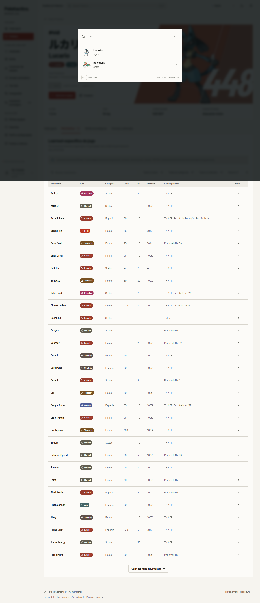

### UX-07 — Opções de transformação são oferecidas para ações que as recusam

**Área:** Construtor e obrigatórios/proibidos do gerador. **Heurísticas:** H4, H5. **Severidade:** 2. **Prioridade:** P1.

**Evidência:** Confirmado por teste — em Z-A o picker permitiu escolher Mega Charizard X (10034); inclusão foi recusada por toast e zero membros. Confirmado por código nos dois pickers do gerador.

**Código:** [src/components/pokemon-detail.tsx](../../src/components/pokemon-detail.tsx):1103–1109; [src/components/team-pages.tsx](../../src/components/team-pages.tsx):203–208, 588–608; [src/lib/team-service.ts](../../src/lib/team-service.ts):16–22; [src/app/api/hub/[...path]/route.ts](../../src/app/api/hub/[...path]/route.ts):211–215.

**Reprodução:** Selecione Z-A no construtor e escolha Charizard · Mega X. No gerador, procure a mesma forma em obrigatórios.

**Atual:** O picker filtra somente canUse e exclude. Analisador e comparador podem usar transformações, mas construtor e serviço de geração não as aceitam como integrantes permanentes.

**Impacto:** O controle promete uma escolha impossível e só explica a restrição depois da ação; iniciante confunde consulta de transformação com posse permanente.

**Esperado/proposta:** Opções dependentes da intenção: consulta inclui transformações, composição de equipe explica sua restrição antes de selecionar.

**Decisão concreta:** Adicionar política de seleção ao picker. Em composição/obrigatórios, manter transformações identificadas como não selecionáveis com explicação legível fora de tooltip e link para consultar ou escolher forma permanente compatível. Em proibidos, limitar ao pool permanente que o gerador realmente considera; explicar que transformações já ficam fora do pool. Não ocultar transformações do catálogo, analisador ou comparador. Manter validação no servidor.

**Dependências:** UX-06; sem ampliar o catálogo factual nem implementar Mega Stones.

**Casos extremos:** Forma alternativa permanente; forma com disponibilidade desconhecida; mega não pertencente ao jogo; limite de seis; visitante; touch sem hover.

**Efeitos colaterais:** Não usar apenas kind != base: formas regionais e alternativas permanentes precisam continuar válidas.

**Aceitação:**

- 10034 nunca entra no rascunho como permanente e a justificativa é apresentada antes da tentativa.
- Mega continua consultável em Z-A e pode ser comparada/analisada.
- Não apresentar desconhecido como indisponibilidade confirmada ou como restrição do usuário.

**Validação:** Unitário da política por intenção; integração UI/serviço; E2E forma temporária e regional permanente, teclado/touch.

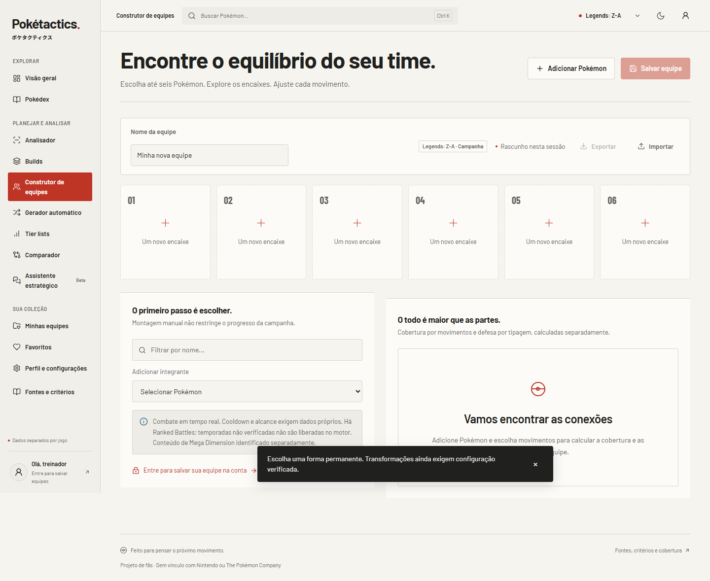

### UX-08 — Escolher movimento em campo vazio muda sua posição

**Área:** MemberEditor em equipes e builds. **Heurísticas:** H2, H4. **Severidade:** 2. **Prioridade:** P2.

**Evidência:** Confirmado por teste — com quatro campos vazios, selecionar Work Up no Movimento 4 produziu valores [526,"","",""]: o movimento apareceu no primeiro campo.

**Código:** [src/components/pokemon-detail.tsx](../../src/components/pokemon-detail.tsx):767–780 (`moves[i]`, `splice`, `filter(Boolean)`); [src/lib/contracts.ts](../../src/lib/contracts.ts) (Member.moves); [src/lib/validation.ts](../../src/lib/validation.ts):memberSchema.

**Reprodução:** No construtor, deixe os quatro movimentos vazios e selecione um movimento no campo 4. Remova o primeiro de uma sequência preenchida.

**Atual:** O array é compactado depois de cada seleção/remoção. A interface mostra posições independentes, mas o estado representa apenas uma lista compacta.

**Impacto:** O usuário perde a referência do campo que acabou de editar; configurações mudam de lugar e a ordem é difícil de controlar.

**Esperado/proposta:** Campos estáveis durante a edição; somente a serialização para o contrato atual remove lacunas.

**Decisão concreta:** Manter quatro slots locais (number|null) com identidade estável e adaptador explícito para Member.moves compacto. Atualizar só o slot acionado; limpar não desloca os demais na interface. Preservar ordem relativa na API/exportação. Não mandar null/undefined ao contrato atual. Sincronizar resets externos por identidade/revisão, sem recompatar toda edição no callback do pai. Manter bloqueio de IDs duplicados.

**Dependências:** Compartilhado por UX-04 e UX-05; não exige mudança de schema.

**Casos extremos:** Ditto/Unown com menos movimentos; remoção do slot 2; sugestão completa; importação; troca de integrante; desfazer substituição.

**Efeitos colaterais:** Contrato compacto não preserva a posição das lacunas entre sessões; documentar que reabrir pode preencher a partir do primeiro slot sem perder a ordem dos movimentos ocupados.

**Aceitação:**

- Escolher no campo 4 mantém campos 1–3 vazios enquanto o editor continua aberto.
- Remover o campo 2 não altera visualmente os campos 3 e 4.
- Salvar/exportar envia até quatro IDs únicos válidos, na ordem visível dos ocupados.

**Validação:** Unitários do adaptador e reducer de slots; integração edição controlada; E2E campos fora de ordem, remoção e retorno de salvamento.

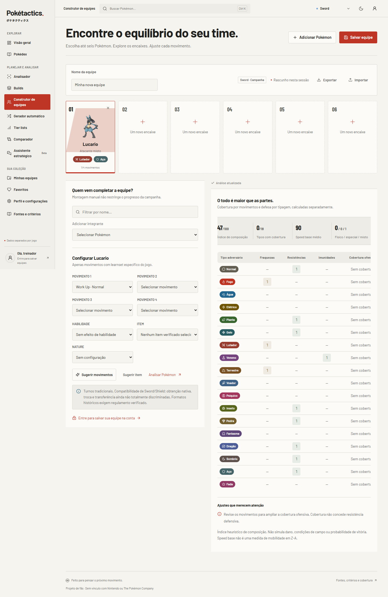

### UX-09 — Trocar um integrante exige excluí-lo antes de escolher o substituto

**Área:** Equipe cheia e experimentação. **Heurísticas:** H3, H7. **Severidade:** 2. **Prioridade:** P2.

**Evidência:** Confirmado por código — slots só selecionam/removem; adicionar é bloqueado em seis; remoção filtra imediatamente o array, sem restauração ou seleção de substituto.

**Código:** [src/components/team-pages.tsx](../../src/components/team-pages.tsx):209–215, 283–286, 325–345, 372–389; [src/components/pokemon-detail.tsx](../../src/components/pokemon-detail.tsx):127–130.

**Reprodução:** Monte seis integrantes. Tente experimentar outra espécie no lugar de um membro, preservando o restante e a possibilidade de cancelar.

**Atual:** O caminho é remover → buscar → adicionar ao fim → reconfigurar; a configuração anterior fica descartada imediatamente.

**Impacto:** Explorar uma alternativa torna-se destrutivo antes de o usuário decidir; comparação exige memorizar a build anterior.

**Esperado/proposta:** Substituição transacional no slot selecionado e restauração do último membro removido.

**Decisão concreta:** Adicionar “Substituir integrante” no editor do slot. Abrir seletor contextual mantendo o time intacto. Ao confirmar nova forma, criar Member vazio e somente então substituir no mesmo índice; nunca copiar golpes ilegais. Se houver rascunho de build compatível explicitamente escolhido, usar UX-04. Cancelar/Escape mantém time e foco. Remover pode manter o último Member e índice em estado temporário até próxima mutação, com ação persistente “Desfazer remoção” no contexto; se outro membro ocupar a vaga, não sobrescrever silenciosamente.

**Dependências:** UX-01/02 e UX-07; UX-06 facilita escolha.

**Casos extremos:** Seis slots; repetição manual permitida; remoção do selecionado; remoções sequenciais; jogo muda antes de desfazer; nova análise atrasada.

**Efeitos colaterais:** Não transformar isto em drag-and-drop/reordenação global ou comparação automática complexa. A melhoria resolve a troca destrutiva observada.

**Aceitação:**

- Substituir mantém seis integrantes e o índice escolhido, sem alterar os outros cinco.
- Cancelar não altera membros, movimentos ou análise válida anterior.
- Desfazer recupera a configuração removida quando ainda aplicável.
- Foco volta ao slot/acionador e a análise corresponde à composição confirmada.

**Validação:** Unitários das operações de slot; integração cancelamento e análise; E2E substituir time completo com mouse/teclado/touch.

### UX-10 — Erros de importação ficam atrás do diálogo

**Área:** Importar equipe e validação. **Heurísticas:** H1, H9. **Severidade:** 3. **Prioridade:** P1.

**Evidência:** Confirmado por teste — JSON “{” produziu erro nativo em inglês no toast; o diálogo continuou aberto sem erro dentro. A captura mostra o toast obscurecido pelo backdrop.

**Código:** [src/components/team-pages.tsx](../../src/components/team-pages.tsx):247–264, 411–453; [src/components/providers.tsx](../../src/components/providers.tsx):147–161; [src/lib/security.ts](../../src/lib/security.ts):43–49; [src/lib/validation.ts](../../src/lib/validation.ts):teamSchema.

**Reprodução:** Abra Importar em /equipes, cole { e clique Validar e importar.

**Atual:** O catch usa notify global, fora do top layer do dialog; a mensagem é a exceção de JSON.parse. Limite de 64 KB usa o mesmo toast. Validação de nome usa posteriormente regras distintas do salvamento.

**Impacto:** O usuário percebe que a importação não ocorreu, mas não recebe diagnóstico acessível no lugar da ação; pode repetir sem saber o que corrigir.

**Esperado/proposta:** Erro persistente em português dentro do modal, com foco e vínculo ao conteúdo inválido; rascunho intacto até conclusão válida.

**Decisão concreta:** Criar importError local ao diálogo, role=alert, aria-describedby e aria-invalid no textarea quando pertinente. Traduzir erro de parse sem expor texto técnico ao usuário. Conferir envelope JSON exportado, tamanho, gameId, nome válido para salvar e array de membros antes de consultar legalidade. Suportar formato version:1 existente; não inferir versão nova. Divergência de jogo oferece cancelar ou abrir importação no jogo declarado através de UX-01, com confirmação da substituição do rascunho destino. Falha não fecha modal, não apaga texto e não altera time. File input deve ter rótulo.

**Dependências:** UX-01/02, mesmas regras Zod e limite de tamanho já adotados; sem relaxar validateMembers.

**Casos extremos:** JSON quebrado; arquivo >64 KB; jogo diferente; nome vazio; zero/sete integrantes; movimento inválido; falha de rede; cancelar após escolher arquivo.

**Efeitos colaterais:** Não comunicar sucesso só porque a análise aceita array vazio; preservar compatibilidade com exportações existentes.

**Aceitação:**

- Erro aparece e é anunciado dentro do diálogo, sem depender de toast.
- Texto e time anterior permanecem intactos após parse/HTTP inválido.
- Arquivo exportado atual continua importando sem perda de ordem/configuração.
- Escape/cancelar restaura foco; importar equipe válida pede confirmação se substituir trabalho pendente.

**Validação:** Unitários do envelope/parser e tradução; integração 400/503/arquivo grande; E2E teclado, import/export real de seis e falhas sem side effects.

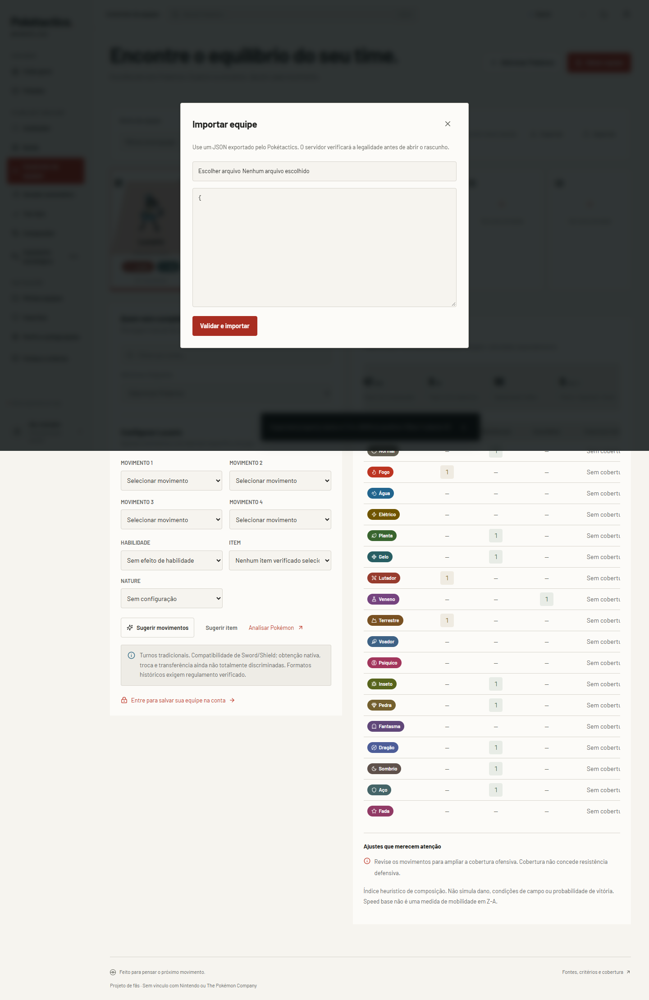

### UX-11 — Excluir equipe ou build é imediato e sem recuperação

**Área:** Coleções pessoais. **Heurísticas:** H3, H5. **Severidade:** 3. **Prioridade:** P1.

**Evidência:** Confirmado por código — clique chama DELETE diretamente; banco usa deleteMany e relações Cascade; UI não oferece confirmação ou desfazer. Nenhum registro real foi excluído nesta auditoria.

**Código:** [src/components/team-pages.tsx](../../src/components/team-pages.tsx):713–720, 759–767; [src/components/tools-pages.tsx](../../src/components/tools-pages.tsx):106–119; [src/app/api/hub/[...path]/route.ts](../../src/app/api/hub/[...path]/route.ts) (DELETE teams/builds); [prisma/schema.prisma](../../prisma/schema.prisma):315–368.

**Reprodução:** Em uma conta sintética de teste, use o ícone Excluir equipe/Excluir build. Inspecionar o handler já demonstra que a primeira ação envia DELETE.

**Atual:** Uma ação em ícone remove definitivamente o registro, e só depois aparece um toast de sucesso.

**Impacto:** Um clique acidental elimina estratégia salva. Ícones próximos a ações de abrir tornam o erro de intenção plausível; frequência real desconhecida.

**Esperado/proposta:** Confirmação explícita com nome e tipo do registro antes da exclusão, mantendo os endpoints atuais.

**Decisão concreta:** Reutilizar dialog nativo com “Excluir equipe/build [nome]?” e consequência; foco inicial em Cancelar, botões nomeados, Escape cancela e restaura foco. Enviar DELETE apenas após confirmar, bloquear dupla submissão e manter erro no modal se falhar. Se o registro aberto para edição for excluído, desvincular ID e preservar conteúdo como rascunho/cópia, avisando que não atualizará registro removido. Não prometer desfazer sem suporte real.

**Dependências:** UX-02; estados compartilhados com UX-10 e UX-18. Sem lixeira/schema novo nesta fase.

**Casos extremos:** Equipe/build em edição; 404 por já ter sido removida; 401; falha de rede; nome duplicado; duplo clique.

**Efeitos colaterais:** Confirmação acrescenta um passo a uma ação rara e irreversível; não acrescentar confirmações a favoritos ou simples seleção.

**Aceitação:**

- Um clique no ícone abre confirmação sem enviar DELETE.
- Cancelar/Escape não altera a coleção.
- Confirmar envia uma única requisição e remove somente o registro nomeado.
- Falha preserva registro na UI e oferece repetir; edição não continua apontando para ID apagado.

**Validação:** Integração de modal e métodos HTTP; E2E somente sobre registros sintéticos descartáveis em banco de teste; simular 404/401/503.

### UX-12 — O gerador mostra resultado de critérios anteriores como se fosse atual

**Área:** Parâmetros → resultado → construtor. **Heurísticas:** H1, H4, H5. **Severidade:** 3. **Prioridade:** P1.

**Evidência:** Confirmado por teste — Z-A com progresso ignorado gera seis integrantes; alterar Integrantes para 1 mantém seis cards e “Ajustar no construtor” ativo.

**Código:** [src/components/team-pages.tsx](../../src/components/team-pages.tsx):480–516 e handlers 546–608; só o efeito de game invalida resultado/requisição.

**Reprodução:** Em /gerador, habilite Ignorar progresso e gere seis. Mude Integrantes para um sem gerar novamente. Clique Ajustar no construtor.

**Atual:** O resultado não guarda os critérios de origem na UI. Alterar estilo, DLC, etapa, tamanho, obrigatórios ou proibidos não o invalida; resposta em trânsito também pode retornar para critérios já alterados.

**Impacto:** O usuário edita ou salva um time que não atende ao pedido visível, incluindo restrições importantes como DLC ou Pokémon proibido.

**Esperado/proposta:** Todo resultado deve ter snapshot dos critérios e estado atual/desatualizado verificável.

**Decisão concreta:** Guardar criteriaSnapshot e requestId por submissão. Ao mudar qualquer parâmetro funcional, marcar resultado desatualizado e bloquear transferência até nova geração; pode manter visualização identificada como resultado anterior. Invalidar respostas da versão antiga e oferecer cancelar processamento sem perder parâmetros. “Outra combinação” usa os critérios atualmente confirmados; reiniciar variant ao mudar critérios, manter determinismo para mesmos dados/entradas/variante.

**Dependências:** Base de estados assíncronos; UX-13 e UX-15 devem invalidar resultado quando alterarem critérios.

**Casos extremos:** Mudar critérios durante processamento; voltar aos mesmos critérios; erro na nova geração; jogo muda; resposta fora de ordem; navegação para outra rota.

**Efeitos colaterais:** Não recalcular automaticamente a cada tecla: geração custa processamento e a decisão de relaxar filtros continua do usuário.

**Aceitação:**

- Mudar 6 → 1 identifica o resultado anterior e impede abrir os seis como resultado atual.
- Alterar banned/DLC em trânsito impede aplicação da resposta antiga.
- Cancelar preserva parâmetros e não mostra sucesso de resposta abandonada.
- Nova geração concluída libera transferência somente com snapshot correspondente.

**Validação:** Unitário de assinatura/revisões; integração com duas respostas fora de ordem; E2E alterar cada tipo de parâmetro e abrir no construtor.

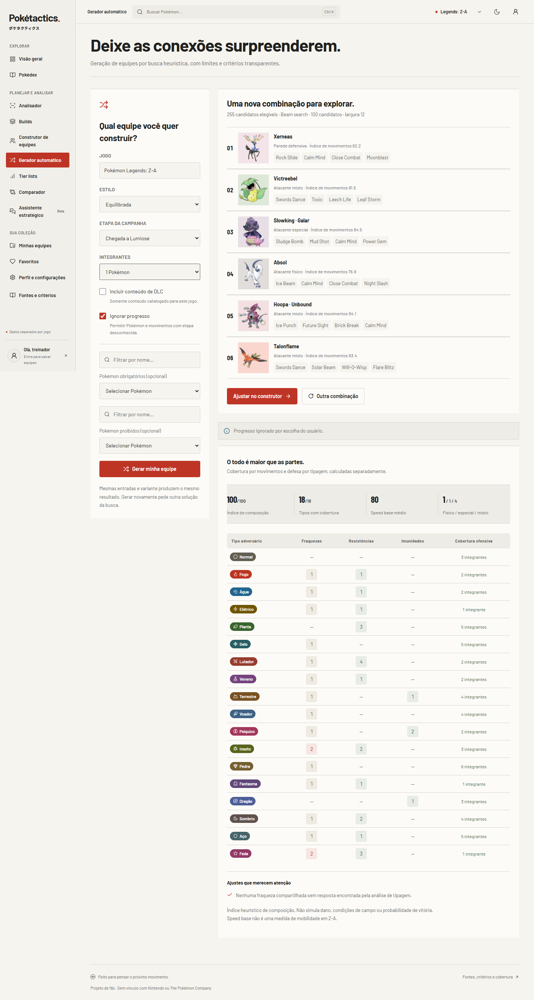

### UX-13 — Contradições de obrigatórios só são explicadas após gerar

**Área:** Gerador: tamanho, obrigatórios e conteúdo. **Heurísticas:** H5, H9. **Severidade:** 2. **Prioridade:** P2.

**Evidência:** Confirmado por código — required pode crescer além de size e até exceder seis na UI; picker exclui apenas IDs já escolhidos/proibidos e não considera DLC/progresso. O motor retorna texto genérico para obrigatório fora dos filtros.

**Código:** [src/components/team-pages.tsx](../../src/components/team-pages.tsx):569–608; [src/lib/validation.ts](../../src/lib/validation.ts):generatorSchema; [src/lib/engine.ts](../../src/lib/engine.ts):435–456.

**Reprodução:** Defina um integrante, adicione dois obrigatórios e gere. Escolha obrigatório de DLC mantendo DLC desligado, quando disponível no pool.

**Atual:** O próprio formulário permite estado contraditório, apesar de o motor impedir a geração e separar required/banned por IDs.

**Impacto:** O usuário precisa descobrir qual escolha conflitou por tentativa e erro; tempo de processamento é gasto numa impossibilidade verificável.

**Esperado/proposta:** Conflitos visíveis junto ao parâmetro e prevenção de submissão, preservando as escolhas para correção.

**Decisão concreta:** Derivar validações locais de tamanho e elegibilidade factual. Exibir “2 obrigatórios para 1 vaga” com ações “Aumentar para 2” e remover chip específico. Não apagar obrigatórios ao reduzir tamanho. Para DLC/progresso, identificar o Pokémon conflitante e o motivo conhecido; disponibilizar remoção ou ativação explícita da opção correspondente. Se etapa for desconhecida, explicar desconhecido e não dizer que é obtido tarde. Manter servidor como autoridade e mapear mensagens conhecidas para a mesma área. Não inventar Species Clause nova para montagem manual.

**Dependências:** UX-06/07 e UX-12; dados `availability` existentes bastam para espécie, mas diagnóstico de etapas dos movimentos é separado em UX-14.

**Casos extremos:** required/banned com conflito importado/restaurado; formas da mesma espécie; jogo muda; tamanho reduzido; etapas desconhecidas; limite 100 proibidos.

**Efeitos colaterais:** Não replicar o motor inteiro no cliente; validação local é só de contradições comprováveis e não promete existência de solução.

**Aceitação:**

- Gerar fica indisponível enquanto required.length > size, com motivo e correção acessíveis.
- Obrigatório incompatível é identificado por nome, sem desaparecer silenciosamente.
- Nenhuma opção de DLC/progresso é ativada sem ação do usuário.
- Servidor continua rejeitando combinações inválidas mesmo se a UI for contornada.

**Validação:** Unitários de preflight de critérios; integração UI/motor; E2E dois obrigatórios/uma vaga, DLC e etapa desconhecida.

### UX-14 — A recuperação do modo estrito sugere reduzir tamanho sem explicar a lacuna

**Área:** Gerador e cobertura de progresso. **Heurísticas:** H2, H9, H10. **Severidade:** 2. **Prioridade:** P2.

**Evidência:** Confirmado por teste — modo padrão em Z-A retorna “Dados elegíveis insuficientes... Tente outro tamanho ou habilite ignorar progresso”. Código/documentação mostram todas as etapas de movimentos desconhecidas no snapshot atual.

**Código:** [src/lib/engine.ts](../../src/lib/engine.ts):257–278, 526–529; [src/components/team-pages.tsx](../../src/components/team-pages.tsx):636–705; docs/MOTOR.md (Geração) e docs/SETUP.md (limitações).

**Reprodução:** Abra /gerador com critérios padrão e gere sem Ignorar progresso. Tente entender por que diminuir o time não corrige a ausência total de movimentos elegíveis.

**Atual:** A tela já informa progresso parcial; o erro não distingue ausência de etapas verificadas de equipe impossível por seleção do usuário.

**Impacto:** Iniciante pode repetir vários tamanhos e etapas sem obter resultado. A base limitada é legítima; o atrito é o diagnóstico insuficiente.

**Esperado/proposta:** Diagnóstico factual e recuperação explícita, sem ativar progresso ignorado automaticamente.

**Decisão concreta:** Retornar motivo estruturado e contagens relevantes do domínio para o gerador: candidatos por disponibilidade, com movimentos elegíveis e motivo de obrigatório rejeitado quando identificável. Se zero por etapa desconhecida, dizer que não há dados verificados suficientes para garantir obtenção e que mudar tamanho pode não resolver. Oferecer “Permitir etapas desconhecidas e gerar” como ação explícita que marca a opção e dispara uma nova requisição. Preservar DLC, obrigatórios e demais filtros. Não chamar ausência de dados de indisponibilidade factual.

**Dependências:** UX-12/13; pode estender resposta de erro com campos opcionais sem alterar fórmulas ou schema. Não há contagem de progresso no health atual: não fabricá-la no cliente.

**Casos extremos:** Obrigatório conhecido mas seus movimentos desconhecidos; zero por banimentos; dados futuros completos; erro HTTP 500 não relacionado ao motor.

**Efeitos colaterais:** Expor contagens não deve sugerir sucesso garantido de beam search nem substituir evidências de progresso.

**Aceitação:**

- Falha por etapa desconhecida recebe mensagem específica e ação voluntária.
- Opt-in não habilita DLC nem remove restrições.
- Com dados futuros de progresso, diagnóstico reflete o pool real e não texto fixo de “sempre indisponível”.

**Validação:** Unitários de códigos de diagnóstico com fixtures de lacuna/filtros; integração API; E2E modo estrito → opt-in → equipe válida.

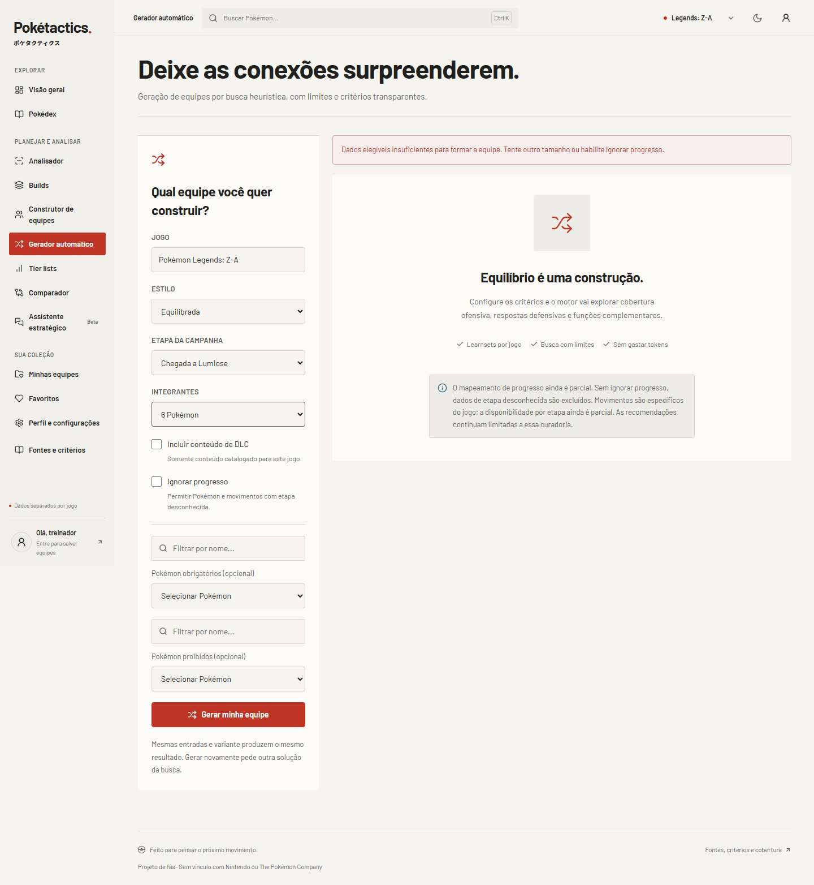

### UX-15 — O gerador não acompanha o progresso salvo do jogo

**Área:** Perfil → gerador → troca de jogo. **Heurísticas:** H4, H6. **Severidade:** 2. **Prioridade:** P2.

**Evidência:** Confirmado por teste com /me simulado — preferências tinham stages.za=3; ao entrar e mudar para Z-A, o gerador exibiu etapa 0. Código inicializa stage uma única vez e não a redefine no efeito de game.

**Código:** [src/components/team-pages.tsx](../../src/components/team-pages.tsx):467–469, 481–489; [src/components/account-page.tsx](../../src/components/account-page.tsx):42–49 e 173–178; [src/components/providers.tsx](../../src/components/providers.tsx):85–96.

**Reprodução:** Salve etapas diferentes por jogo no perfil. Entre diretamente no gerador e altere jogo, inclusive antes/depois de a sessão carregar.

**Atual:** A inicialização pode ocorrer antes de Personal chegar; a etapa fica na anterior/default e as preferências por jogo não são reaplicadas.

**Impacto:** O usuário precisa lembrar e repetir uma preferência que já salvou; os filtros visíveis podem não corresponder ao seu progresso.

**Esperado/proposta:** Inicializar cada jogo com sua etapa salva, preservando ajustes manuais feitos no gerador.

**Decisão concreta:** Criar estado de critérios por jogo com flag de edição manual por campo. Aplicar stages[game] quando preferências carregarem e o campo ainda não foi tocado; fallback stage legado somente para o jogo principal correspondente. Ao trocar jogo, restaurar critérios daquele jogo ou sua preferência. Nunca sobrescrever uma edição local por resposta de /me atrasada. Deixar claro se a etapa foi ajustada só para a geração.

**Dependências:** UX-12; aproveitar política de hidratação de UX-18.

**Casos extremos:** Visitante; preferência antiga stage sem stages; resposta lenta; usuário já editou; etapa fora do intervalo; sair/entrar em outra conta.

**Efeitos colaterais:** Não aplicar legacy stage de Sword a Arceus por conveniência; política precisa ser explícita.

**Aceitação:**

- Com stages.za=3, primeira entrada não editada em Z-A mostra Pós-jogo.
- Editar etapa antes da resposta da sessão impede sobrescrita tardia.
- Trocar entre jogos restaura a etapa correspondente e invalida resultado antigo.

**Validação:** Unitários de precedência salvo/local; integração /me atrasado; E2E perfil com etapas distintas em três jogos.

### UX-16 — Voltar da ficha para a Pokédex perde o recorte de pesquisa

**Área:** Catálogo/favoritos → ficha → retorno. **Heurísticas:** H3, H6, H7. **Severidade:** 2. **Prioridade:** P2.

**Evidência:** Confirmado por teste — buscar Luc, abrir Lucario e clicar Voltar à Pokédex devolveu busca vazia. Código mantém filtros/página locais e usa href fixo /pokedex.

**Código:** [src/components/dashboard-catalog.tsx](../../src/components/dashboard-catalog.tsx):412–421; [src/components/pokemon-detail.tsx](../../src/components/pokemon-detail.tsx):138–140; [src/components/pokemon-ui.tsx](../../src/components/pokemon-ui.tsx):183.

**Reprodução:** Defina pesquisa/filtros/ordenação e página na Pokédex; abra uma ficha e use o link de retorno da ficha.

**Atual:** O link ignora origem, query, ordenação, paginação e contexto de favoritos. Não há serialização do recorte na URL.

**Impacto:** Explorar candidatos exige reconstruir repetidamente filtros e localizar o card; ao partir dos favoritos, o retorno leva ao catálogo geral.

**Esperado/proposta:** Recorte explícito e restaurável, com retorno seguro à origem local conhecida.

**Decisão concreta:** Serializar query, filtros, sort, page e game em searchParams, validando valores. Digitação usa replace sem gerar histórico por tecla; mudanças confirmadas/paginação podem gerar entradas úteis. Card carrega referência local à lista de origem ou o provider guarda contexto validado. Link da ficha retorna à lista/favoritos com recorte e posiciona foco no card de origem. Link direto sem origem usa /pokedex. Não usar back cego que possa sair do produto; não aceitar returnTo arbitrário externo.

**Dependências:** Helper de busca UX-06. Ler guias locais Next.js sobre useSearchParams e navegação antes de implementar.

**Casos extremos:** Reload; acesso direto; voltar/avançar navegador; filtros sem resultado no novo jogo; número de página fora do intervalo; origem favoritos sem sessão.

**Efeitos colaterais:** URLs não devem conter dados privados da conta; favoritos são identificador de rota, nunca lista de IDs privados.

**Aceitação:**

- Retorno explícito conserva pesquisa, filtros, ordenação, página e jogo válidos.
- Back/Forward percorre estados úteis e reload reproduz a lista.
- Card/origem recebe foco ou fallback previsível; link externo em returnTo é ignorado.

**Validação:** Unitários de parse/serialize/allowlist; integração roteamento; E2E catálogo e favoritos → ficha → voltar, inclusive na página 2.

### UX-17 — Busca de movimentos sem resultado parece falta de dados

**Área:** Learnset e filtros. **Heurísticas:** H2, H9. **Severidade:** 2. **Prioridade:** P2.

**Evidência:** Confirmado por teste — Lucario tinha 79 movimentos; query zzzz-no-match mostrou “Nenhum movimento verificado neste recorte” e justificativa sobre lacunas de outro jogo.

**Código:** [src/components/pokemon-detail.tsx](../../src/components/pokemon-detail.tsx):536–567 e 703–709.

**Reprodução:** Na ficha de Lucario em Sword, abra Movimentos e busque zzzz-no-match.

**Atual:** A mesma mensagem é usada quando a base tem zero movimentos e quando os filtros eliminam todos os existentes; não há ação contextual para limpar filtros.

**Impacto:** O usuário atribui o vazio à curadoria e pode desistir em vez de corrigir a consulta.

**Esperado/proposta:** Distinguir zero na fonte de zero no recorte, mostrando a próxima ação correta.

**Decisão concreta:** Se moves.length > 0 e list.length === 0, mostrar “Nenhum movimento corresponde aos filtros” e “Limpar filtros”, que reseta query/tipo/categoria/método e paginação. Quando moves.length === 0, manter aviso factual da cobertura. Mostrar contagem filtrada/total próxima à tabela e resetar página de carregamento ao mudar filtros para resultado previsível.

**Dependências:** UX-06 para normalização comum, sem exigir novo buscador de movimentos completo.

**Casos extremos:** Combinação tipo+categoria; lista original vazia; troca de jogo; paginação expandida; query só de espaços.

**Efeitos colaterais:** Mensagens não devem afirmar que todos os movimentos são verificados só porque foram cadastrados; preservar flags de propriedades.

**Aceitação:**

- 79 movimentos com filtro sem correspondência não é apresentado como learnset ausente.
- Limpar filtros restaura os registros sem trocar jogo/Pokémon.
- Zero real da base continua explicitamente desconhecido e não inventa alternativas.

**Validação:** Integração com 0 registros, N registros e 0 após filtro; E2E query e combinação de selects, contagens e limpar.

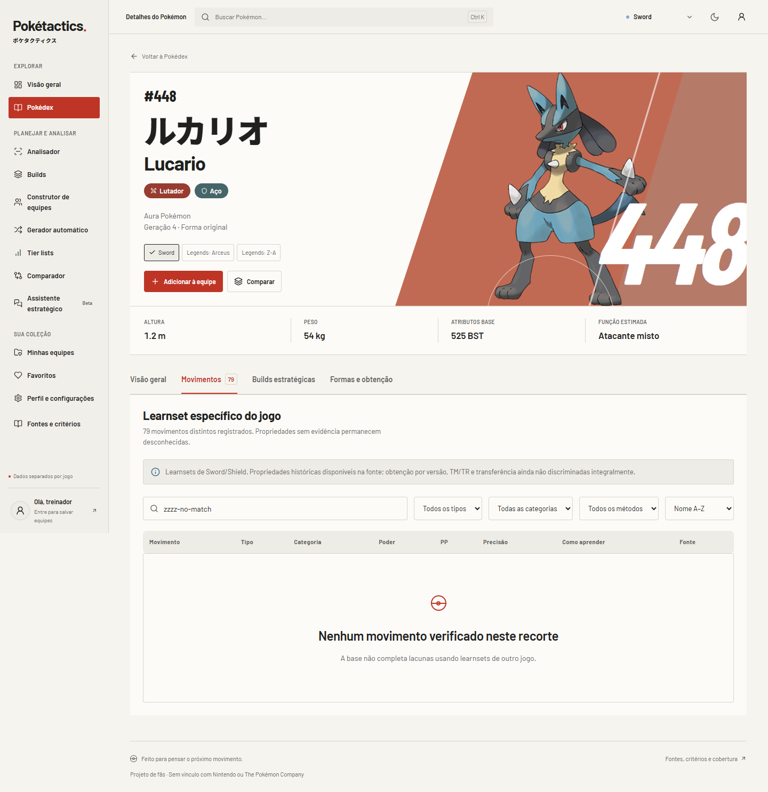

### UX-18 — Falha ao carregar a sessão é apresentada como usuário deslogado

**Área:** Provider, favoritos, perfil e coleções. **Heurísticas:** H1, H9. **Severidade:** 3. **Prioridade:** P1.

**Evidência:** Confirmado por teste com HTTP 503 simulado em /api/hub/me — /favoritos mostrou “Sua coleção começa com uma conta”. O mesmo catch trata qualquer erro como personal=null.

**Código:** [src/components/providers.tsx](../../src/components/providers.tsx):40–49, 85–96; [src/components/dashboard-catalog.tsx](../../src/components/dashboard-catalog.tsx):498–512; [src/components/account-page.tsx](../../src/components/account-page.tsx):110–126; [src/components/team-pages.tsx](../../src/components/team-pages.tsx):743–753.

**Reprodução:** Intercepte /api/hub/me com 503 e abra favoritos/perfil/minhas-equipes; comparar com resposta 401.

**Atual:** O wrapper perde status HTTP ao lançar Error; refresh apaga Personal em qualquer falha e as telas confundem carregamento/falha com ausência de conta.

**Impacto:** O usuário teme que seus dados sumiram ou tenta entrar novamente; uma falha posterior pode substituir a coleção na tela por convite de cadastro.

**Esperado/proposta:** Estados distintos de sessão: carregando, autenticado, visitante confirmado e indisponível. Erro transitório permite repetir sem apagar trabalho local.

**Decisão concreta:** Criar erro tipado com status e estado explícito no provider. Somente 401 confirmado marca visitante; 5xx/rede marcam erro de sincronização. Mostrar último conteúdo pessoal apenas na mesma sessão já validada, como desatualizado; em primeira carga exibir falha e botão repetir. Evitar flicker de cadastro enquanto personalLoading. Em mutação seguida de refresh falho, distinguir “gravação concluída; não foi possível atualizar a lista” de gravação fracassada para evitar duplo POST. 401/logout limpa dados privados e IDs; manter rascunho conforme política de propriedade.

**Dependências:** Base para UX-02, UX-11, UX-15; segurança de sessão/ownership existente deve continuar no servidor.

**Casos extremos:** 401; 403; 429; 500; rede offline; JSON inválido; resposta antiga após logout; refresh após salvar; outra conta.

**Efeitos colaterais:** Manter conteúdo antigo após logout/401 seria exposição entre contas; descarte obrigatório nesses casos.

**Aceitação:**

- 503 em /me mostra erro e Repetir, nunca convite de cadastro como único estado.
- 401 confirmado apresenta login e elimina conteúdo privado da sessão anterior.
- Falha de refresh após POST bem-sucedido não permite criar cópia por retry indiscriminado.
- Nenhum refresh altera campos locais ainda não salvos.

**Validação:** Unitários de erro tipado/status e reducer de sessão; integração estados e mutação+refresh; E2E interceptações 401/503 e reconexão, mais persistência real com conta sintética.

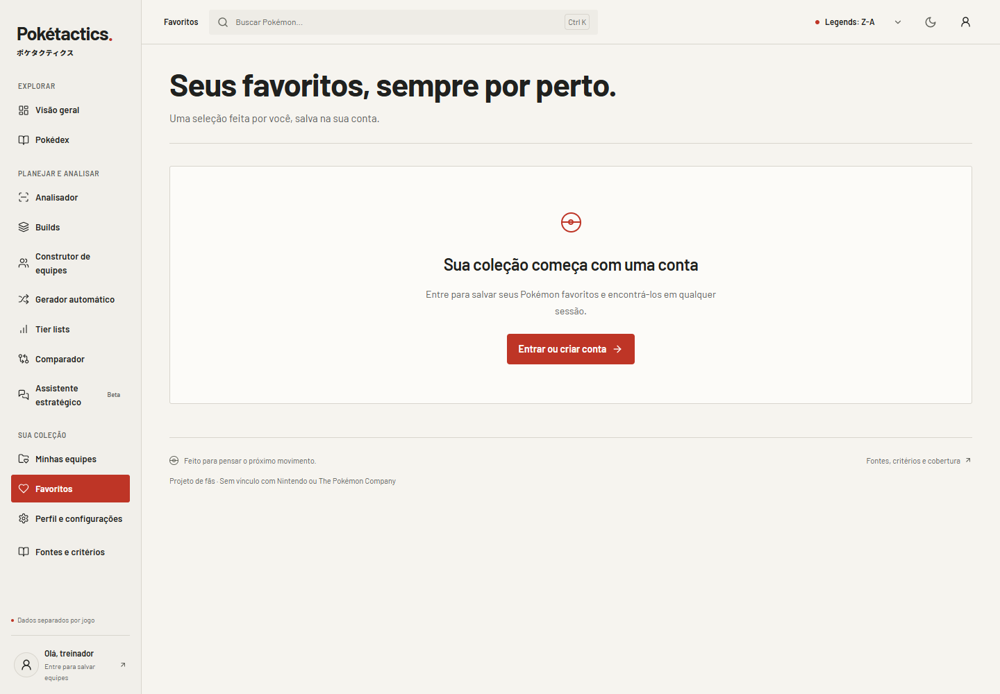

### UX-19 — Fontes permanece “Consultando...” depois de uma falha

**Área:** Fontes e critérios. **Heurísticas:** H1, H9. **Severidade:** 2. **Prioridade:** P2.

**Evidência:** Confirmado por teste — health com 503 simulado exibiu erro e “Consultando...” permanente; `sources` ficou zero porque Promise.all descartou também o sucesso de fontes.

**Código:** [src/components/tools-pages.tsx](../../src/components/tools-pages.tsx):647–696; efeito usa Promise.all sem estados separados nem retry.

**Reprodução:** Intercepte apenas /api/hub/health com 503 e abra /fontes, deixando /sources responder normalmente.

**Atual:** A exceção não finaliza estado de carregamento; ausência é representada como 0 fontes e nenhum controle tenta novamente.

**Impacto:** A página de confiança transmite status contraditório e oculta informação disponível por falha de outra consulta.

**Esperado/proposta:** Estados independentes e terminais para saúde/fontes, com recuperação localizada.

**Decisão concreta:** Separar loading/error/data de cada recurso (Promise.allSettled ou consultas separadas). Após falha, exibir “Não foi possível consultar o estado” e contagem desconhecida como —, nunca zero factual. Conservar fonte já carregada e tabela estática de limites; oferecer Repetir para o recurso afetado. Usar status para carregamento e alert para falha. Evitar afirmar banco desconectado se foi só erro no cliente.

**Dependências:** Pode reutilizar erro tipado de UX-18; sem mudar o conteúdo de DESIGN.md ou inventário factual.

**Casos extremos:** Só sources falha; só health falha; ambos; retry com sucesso; retorno fora de ordem; desmontagem.

**Efeitos colaterais:** Separar requests pode mostrar dados com instantes diferentes; indicar último estado sem prometer snapshot transacional.

**Aceitação:**

- Depois de 503 não resta indicador “Consultando...” ativo.
- Sources 200 permanece visível se health falhar.
- Repetir recupera indicadores sem recarregar toda aplicação.

**Validação:** Integração de quatro combinações de respostas; E2E 503 em health, depois sucesso, e erro em sources.

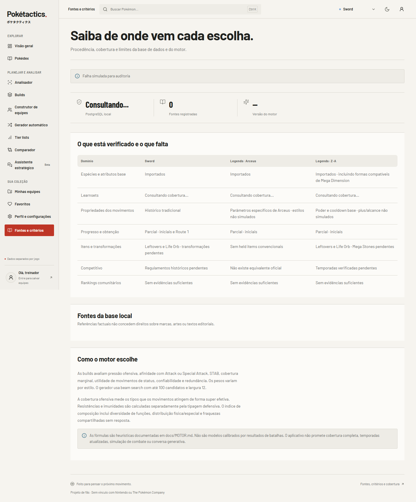

### UX-20 — O assistente mistura contexto selecionado e relatório anterior e perde a anotação no erro

**Área:** Assistente por regras. **Heurísticas:** H1, H3, H9. **Severidade:** 2. **Prioridade:** P2.

**Evidência:** Confirmado por teste — depois de analisar Lucario, selecionar Pikachu manteve o relatório de Lucario sob contexto Pikachu; falha de rede simulada limpou a anotação e mostrou “Failed to fetch”.

**Código:** [src/components/tools-pages.tsx](../../src/components/tools-pages.tsx):505–546, 562, 572–576; API assistant guarda contexto em ChatMessage, mas Personal.conversations não o tipa/exibe.

**Reprodução:** Analise Lucario, troque o Pokémon selecionado e observe a conversa. Preencha anotação e provoque erro de rede na próxima análise.

**Atual:** Mensagens não têm cabeçalho explícito de game/formId por relatório. A resposta menciona a espécie no texto, mas a mudança do seletor não separa contexto atual e anterior. O input é limpo antes do sucesso e não há retry dedicado.

**Impacto:** É fácil atribuir um relatório à seleção errada; falha custa redigitar a anotação. Histórico salvo pode acentuar a ambiguidade.

**Esperado/proposta:** Relatórios com origem explícita e operação recuperável, mantendo o modo determinístico.

**Decisão concreta:** Registrar formId/gameId e anotação no snapshot de cada submissão; exibir nome e jogo no cabeçalho de cada relatório. Trocar seletor não deve relabelar mensagens antigas. Indicar “Contexto da próxima análise” e preservar conversa identificada, sem apagá-la automaticamente. Manter anotação até sucesso ou restaurá-la na falha, com “Tentar novamente” usando snapshot original. Se contexto mudou, informar qual será reprocessado; impedir resposta tardia de se passar pela seleção nova. Tratar HTTP/rede em português. Ao usar histórico legado sem metadados, sinalizar origem não registrada; não inventá-la. Atualizar histórico opt-in após gravação confirmada se o usuário precisar abri-lo na mesma sessão.

**Dependências:** UX-06, UX-18 e revisão de respostas obsoletas de UX-12 como padrão. API já oferece contexto em mensagens; verificar projeção antes de ampliar contrato.

**Casos extremos:** Trocar Pokémon durante cálculo; abrir histórico de outro jogo; anotação vazia; histórico desativado; offline; resposta após desmontagem; legado sem contexto.

**Efeitos colaterais:** Não transformar o problema em pedido de chat generativo. Nenhuma API de IA, chave ou custo é necessário.

**Aceitação:**

- Relatório de Lucario continua identificado como Lucario/Sword após selecionar Pikachu.
- Falha preserva anotação e oferece retry inequívoco sem duplicar relatório como sucesso.
- Resposta antiga não recebe o título do contexto novo.
- O sistema continua informando que anotação não é interpretada por LLM.

**Validação:** Unitários de snapshots/retry; integração mudança de contexto/histórico; E2E Lucario → Pikachu, falha/retry e troca de jogo.

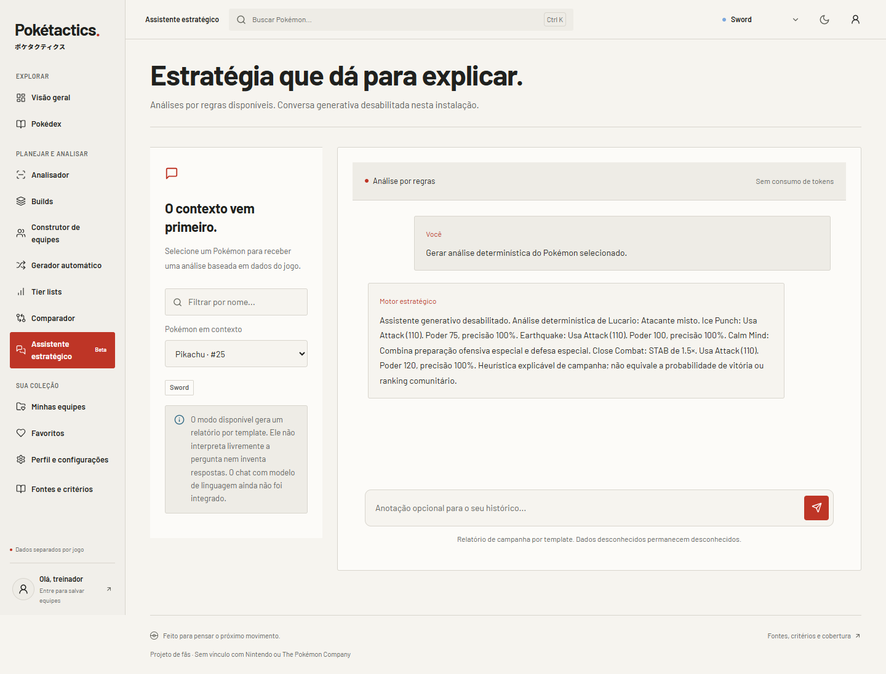

### Hipóteses separadas: não entram no plano automático nem na contagem

| ID     | Indício e limite                                                                                                                                                                                           | Como confirmar/refutar antes de propor implementação                                                                                                                                                                                   |
| ------ | ---------------------------------------------------------------------------------------------------------------------------------------------------------------------------------------------------------- | -------------------------------------------------------------------------------------------------------------------------------------------------------------------------------------------------------------------------------------- |
| HYP-01 | team-pages.tsx:175–199: limpar último membro enquanto análise pendente pode deixar `analyzing` verdadeiro; retorno vazio não o reseta e finally ativo anterior é descartado. Não reproduzido nesta rodada. | Interceptar analyze com atraso, remover último, resolver a requisição; conferir indicador e ausência de métricas antigas. Confirmar também debounce e troca de jogo.                                                                   |
| HYP-02 | Comparator inicializa IDs a partir de searchParams só no useState; seleção não é serializada. Cache/montagem do Next pode alterar a reprodução de links sucessivos e Back.                                 | Em mesma sessão abrir comparador da ficha A, mudar picks, voltar e abrir da ficha B. Comparar reload, Link, Back/Forward e troca de jogo. Exigir que o Pokémon do link corresponda ao painel; só então especificar correção adicional. |
| HYP-03 | Histórico do assistente depende de Personal.conversations; send não chama refresh. O projection atual não tipa contexto embora servidor grave em mensagem.                                                 | Com conta sintética e opt-in, analisar, observar histórico sem reload, recarregar, abrir conversa de outro jogo. UX-20 prevê metadados verificáveis; não inventar contexto de registros antigos.                                       |
| HYP-04 | Histórico limita 12 consultas/20 conversas no servidor; equipes/builds são carregadas integralmente e sua paginação é pendência documentada. Não houve amostra com volume real nem medição de desempenho.  | Criar fixture isolada com centenas de equipes/builds, comparar total do banco e exibido, medir localização e leitura. Não implementar paginação apenas por convenção.                                                                  |
| HYP-05 | Formulários devolvem mensagens de Zod por path/inglês; sem rodada autenticada não houve reprodução de todos os erros de nome/build/senha UTF-8.                                                            | Validar nome com 1 caractere, email inválido, senha >72 bytes e 401/429. Confirmar texto, associação ao campo e foco; ampliar UX-18 somente após evidência.                                                                            |

## 11. Melhorias propostas

Não há redesign. As vinte decisões funcionais acima são a lista integral para a etapa posterior; critérios e testes também estão no prompt. Priorizar: preservação de rascunho e identidade (UX-01/02/03), ponte de build (UX-04/05), resultado do gerador confiável (UX-12), erro recuperável (UX-10/18). O combobox (UX-06) beneficia muitas ferramentas, mas exige mais validação acessível que ajustes locais de mensagem.

### Benchmarking funcional e adaptações

Fontes consultadas nesta rodada; os padrões abaixo informam alternativas, não provam defeitos locais. Não foram importados dados estratégicos ou layouts desses produtos.

| Referência / evidência acessível                                                                                                                    | Problema análogo e interação                                                                        | Adequação/adaptação                                                                                                                | Desvantagem/limite                                                                                                                                                                                                        |
| --------------------------------------------------------------------------------------------------------------------------------------------------- | --------------------------------------------------------------------------------------------------- | ---------------------------------------------------------------------------------------------------------------------------------- | ------------------------------------------------------------------------------------------------------------------------------------------------------------------------------------------------------------------------- |
| [Showdown, código do teambuilder](https://github.com/smogon/pokemon-showdown-client/blob/master/play.pokemonshowdown.com/src/panel-teambuilder.tsx) | Handler `undeleteteam` e placeholder de recuperação mostram remoção recuperável no cliente.         | Controle após ação destrutiva; no Pokétactics preferir confirmação nativa antes de DELETE real (UX-11), que dispensa lixeira nova. | Undo local do Showdown não demonstra recuperação de registro SQL; não copiar promessa de desfazer sem backend. A página dinâmica não pôde ser inspecionada pelo extrator web, portanto não se afirma teste do fluxo vivo. |
| [Showdown, editor de equipe](https://github.com/smogon/pokemon-showdown-client/blob/master/play.pokemonshowdown.com/src/panel-teambuilder-team.tsx) | Código distingue armazenamento local/conta, mudanças pendentes, comparar/restaurar versão enviada.  | Explicitar rascunho vs salvo e destino de atualização (UX-02/03); manter o salvamento explícito existente.                         | Não importar sincronização pública, upload ou autosave remoto; são regras diferentes.                                                                                                                                     |
| [Pokémon Database, Lucario](https://pokemondb.net/pokedex/lucario)                                                                                  | Índice local para atributos, evolução, movimentos e locais; recorte de geração/jogo nos movimentos. | Preservar descoberta e retorno contextual da ficha (UX-16/17), usando abas atuais e jogo do produto.                               | Página extensa e dados de várias gerações não são modelo para fundir regras; não adicionar conteúdo sem base.                                                                                                             |
| [Serebii, Lucario Sword/Shield](https://www.serebii.net/pokedex-swsh/lucario/)                                                                      | Tabelas e âncoras separam aprendizado e métodos por contexto.                                       | Mostrar filtro/total e diagnóstico de recorte vazio, conservar fonte ao lado do movimento (UX-17).                                 | Densidade de tabelas não deve ser copiada; no celular manter regiões de rolagem já existentes.                                                                                                                            |
| [Smogon, Lucario SS](https://www.smogon.com/dex/ss/pokemon/lucario/)                                                                                | A página respondeu apenas Loading ao extrator.                                                      | Nenhum padrão específico aprovado a partir desta página; referência estratégica já existe no produto.                              | Não alegar inspeção de sets/seletores ou usar ranking comunitário como nota de campanha.                                                                                                                                  |
| [WAI-ARIA, combobox](https://www.w3.org/WAI/ARIA/apg/patterns/combobox/)                                                                            | Um campo pode permitir filtrar e confirmar opção da lista.                                          | UX-06 precisa seleção manual, cancelamento e metadados de forma; manter tokens existentes.                                         | Padrão de referência, sem prova de ganho com usuários locais; controle customizado aumenta custo de acessibilidade.                                                                                                       |

## 12. Matriz de priorização

Frequências são estimadas por exposição na jornada, sem analytics. Não usar uma soma numérica de impacto ficticiamente precisa. Prioridade considera risco de perder trabalho, alcance e dependências; complexidade G pode começar pela base e ter entregas menores.

| ID    | Severidade | Prioridade | Esforço | Frequência estimada                                         | Justificativa prática                                                                                                                                 |
| ----- | ---------: | ---------- | ------- | ----------------------------------------------------------- | ----------------------------------------------------------------------------------------------------------------------------------------------------- |
| UX-01 |          3 | P1         | G       | Alta em exploração entre jogos; estimativa, sem telemetria. | Um usuário recorrente perde trabalho mesmo quando só pretendia consultar outro jogo; formas relacionadas podem causar a mesma perda indiretamente.    |
| UX-02 |          3 | P1         | G       | Alta para retomada; estimativa.                             | O usuário pode criar uma cópia involuntária, perder o título e acreditar que está atualizando o registro original.                                    |
| UX-03 |          3 | P1         | M       | Média para recorrentes; estimativa.                         | O rótulo de criação induz o usuário a modificar uma equipe existente; há risco de sobrescrita por engano.                                             |
| UX-04 |          3 | P1         | M       | Alta na jornada consultar → planejar; estimativa.           | O usuário repete quatro escolhas e configurações, podendo inserir uma build diferente da que acabou de avaliar.                                       |
| UX-05 |          3 | P1         | G       | Alta para experimentação avançada; estimativa.              | Experimentação estratégica custa retrabalho e desestimula consultar o learnset durante a edição.                                                      |
| UX-06 |          2 | P2         | G       | Alta: seletor usado em cinco ferramentas; estimativa.       | A tarefa repetida de seleção exige mudança de controle. Espaços ao colar causam falsos vazios. A navegação de sugestões difere entre ferramentas.     |
| UX-07 |          2 | P1         | M       | Média, especialmente em Z-A; estimativa.                    | O controle promete uma escolha impossível e só explica a restrição depois da ação; iniciante confunde consulta de transformação com posse permanente. |
| UX-08 |          2 | P2         | M       | Média na edição manual; estimativa.                         | O usuário perde a referência do campo que acabou de editar; configurações mudam de lugar e a ordem é difícil de controlar.                            |
| UX-09 |          2 | P2         | M       | Média para intermediários e avançados; estimativa.          | Explorar uma alternativa torna-se destrutivo antes de o usuário decidir; comparação exige memorizar a build anterior.                                 |
| UX-10 |          3 | P1         | M       | Média; bloqueia recuperação quando ocorre.                  | O usuário percebe que a importação não ocorreu, mas não recebe diagnóstico acessível no lugar da ação; pode repetir sem saber o que corrigir.         |
| UX-11 |          3 | P1         | M       | Baixa/média, consequência alta; estimativa.                 | Um clique acidental elimina estratégia salva. Ícones próximos a ações de abrir tornam o erro de intenção plausível; frequência real desconhecida.     |
| UX-12 |          3 | P1         | M       | Alta em iteração do gerador; estimativa.                    | O usuário edita ou salva um time que não atende ao pedido visível, incluindo restrições importantes como DLC ou Pokémon proibido.                     |
| UX-13 |          2 | P2         | M       | Média em configurações avançadas; estimativa.               | O usuário precisa descobrir qual escolha conflitou por tentativa e erro; tempo de processamento é gasto numa impossibilidade verificável.             |
| UX-14 |          2 | P2         | M       | Alta na primeira geração por padrão; estimativa.            | Iniciante pode repetir vários tamanhos e etapas sem obter resultado. A base limitada é legítima; o atrito é o diagnóstico insuficiente.               |
| UX-15 |          2 | P2         | M       | Média/alta para recorrentes; estimativa.                    | O usuário precisa lembrar e repetir uma preferência que já salvou; os filtros visíveis podem não corresponder ao seu progresso.                       |
| UX-16 |          2 | P2         | M       | Alta em exploração; estimativa.                             | Explorar candidatos exige reconstruir repetidamente filtros e localizar o card; ao partir dos favoritos, o retorno leva ao catálogo geral.            |
| UX-17 |          2 | P2         | P       | Média em consulta de movimentos; estimativa.                | O usuário atribui o vazio à curadoria e pode desistir em vez de corrigir a consulta.                                                                  |
| UX-18 |          3 | P1         | G       | Ocasional, atinge várias jornadas; estimativa.              | O usuário teme que seus dados sumiram ou tenta entrar novamente; uma falha posterior pode substituir a coleção na tela por convite de cadastro.       |
| UX-19 |          2 | P2         | P       | Baixa frequência, efeito na confiança; estimativa.          | A página de confiança transmite status contraditório e oculta informação disponível por falha de outra consulta.                                      |
| UX-20 |          2 | P2         | M       | Média na exploração do assistente; estimativa.              | É fácil atribuir um relatório à seleção errada; falha custa redigitar a anotação. Histórico salvo pode acentuar a ambiguidade.                        |

| Severidade                                              | Quantidade |
| ------------------------------------------------------- | ---------: |
| 0 (comportamentos adequados, sem contagem de problemas) |          — |
| 1 marginal                                              |          0 |
| 2 menor                                                 |         11 |
| 3 maior                                                 |          9 |
| 4 crítico                                               |          0 |

## 13. Dependências e riscos

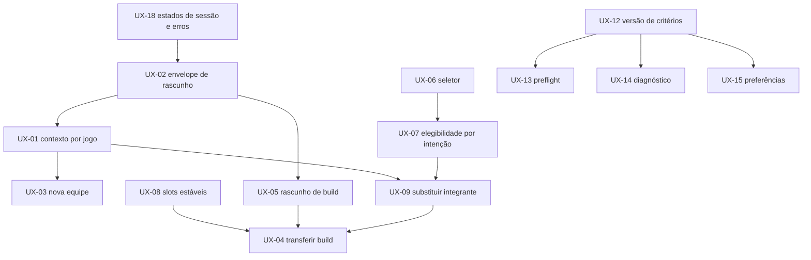

Risco central: resolver continuidade sem misturar legalidade entre jogos ou dados de contas. Reusar gameSchema, Member, validação server-side e políticas da sessão. Envelopes locais não concedem autorização. Coleções antigas, logout, storage indisponível e respostas atrasadas precisam de testes. Evitar dependência circular entre provider e componentes de tela: extrair transições/adaptadores puros quando necessários, não criar framework genérico.

Dados: UX-14 requer derivar diagnóstico do pool real, pois health atual não fornece contagem de etapas; UX-20 requer conferir projeção do contexto do histórico. Nenhuma proposta exige dados novos de captura, simulação competitiva ou API de IA. Explicar desconhecido, indisponibilidade factual e exclusão voluntária como estados distintos. Não mudar fórmulas STAB/defesa, recursos PP/cooldown, conjunto de natures, min/max de equipe, propriedade ou opt-in de histórico para simplificar UI.

## 14. Oportunidades descartadas e justificativas

- Redesign de cards, cores, tipografia, sidebar, radar e espaçamento: fora do objetivo e sem defeito funcional demonstrado.
- “Adicionar autocomplete porque falta busca dinâmica”: premissa falsa; filtro já é dinâmico. UX-06 reduz troca de controle e corrige normalização.
- Bloquear duplicação de espécies no construtor manual: domínio atual permite; regra sem formato importado não deve ser criada. Gerador já busca diversidade por espécie; caso de obrigatórios da mesma espécie requer validação de regra antes de mudar algoritmo.
- Habilitar ignorar progresso/DLC automaticamente: removeria escolha e mudaria promessa de obtenção.
- Completar LLM, rankings, Mega Stones, Dynamax, simulação Arceus/Z-A, EVs/IVs e captura: são limites de escopo/dados conhecidos, não correções de usabilidade disfarçadas.
- Reordenar integrantes por arrastar: sem consequência de ordem modelada que justifique novo mecanismo; UX-09 preserva slot na substituição e resolve o atrito demonstrado.
- Gerar sugestões de substituto a partir de qualquer fraqueza com ranking novo: exige regra estratégica/calibração, não só interface. Usar o comparador existente é suficiente para a primeira fase.
- “Winner” único no comparador, radar de quatro e expandir todas as tiers sem demanda: limites atuais são explicitados; não houve evidência de tarefa bloqueada que justifique a complexidade nesta etapa.
- Tours obrigatórios, gamificação, notificações, favoritos locais paralelos e coleções novas: sem pesquisa ou necessidade demonstrada; aumentariam escopo e inconsistência.
- Eliminar confirmação de ação destrutiva para reduzir cliques: eficiência deve considerar custo de erro; UX-11 a adiciona porque DELETE é irreversível no produto.
- Telemetria como pré-requisito de toda correção: não impede resolver perdas reproduzidas. Uma pesquisa futura pode medir frequência e calibrar ordem, sem afirmar benefícios percentuais agora.

## 15. Conclusão

Os maiores ganhos esperados vêm de preservar intenção e contexto e tornar erros corrigíveis. Os vinte itens têm correspondência de IDs e aceitação no prompt autossuficiente. Comparador, tiers, fontes, conta e assistente foram incluídos com limites explícitos; nenhuma área não testada é apresentada como validada integralmente. A segunda revisão sob o perfil iniciante verificou clareza de indisponibilidade/erro; sob o avançado verificou preservação de builds, teclado e liberdade de escolha. É revisão heurística, sem participação de usuários reais.

**Nenhuma mudança funcional foi realizada e DESIGN.md permaneceu intacto. O plano está pronto para revisão do usuário; o prompt não foi executado.**
