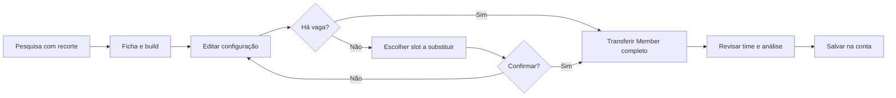
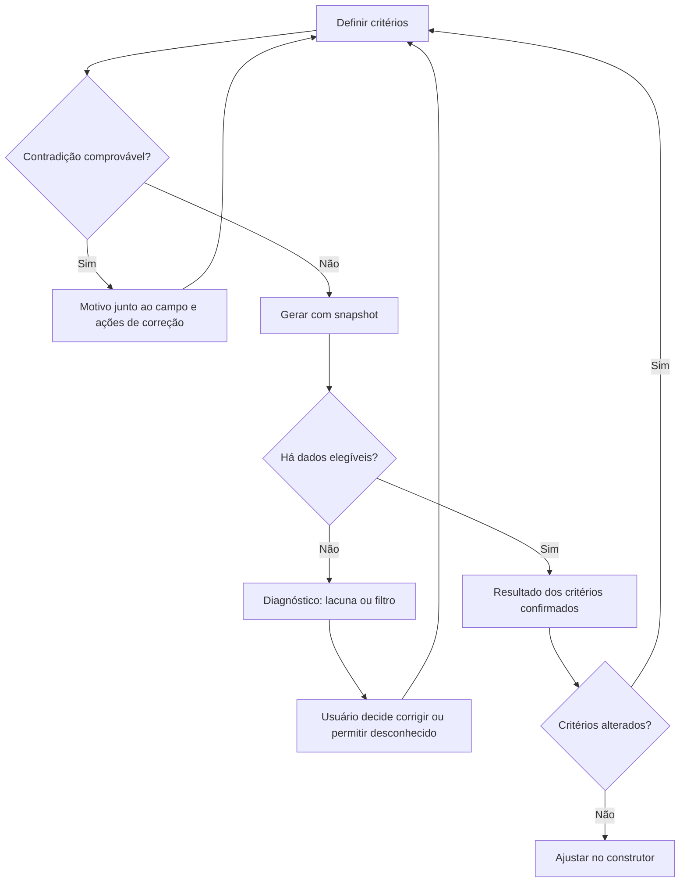
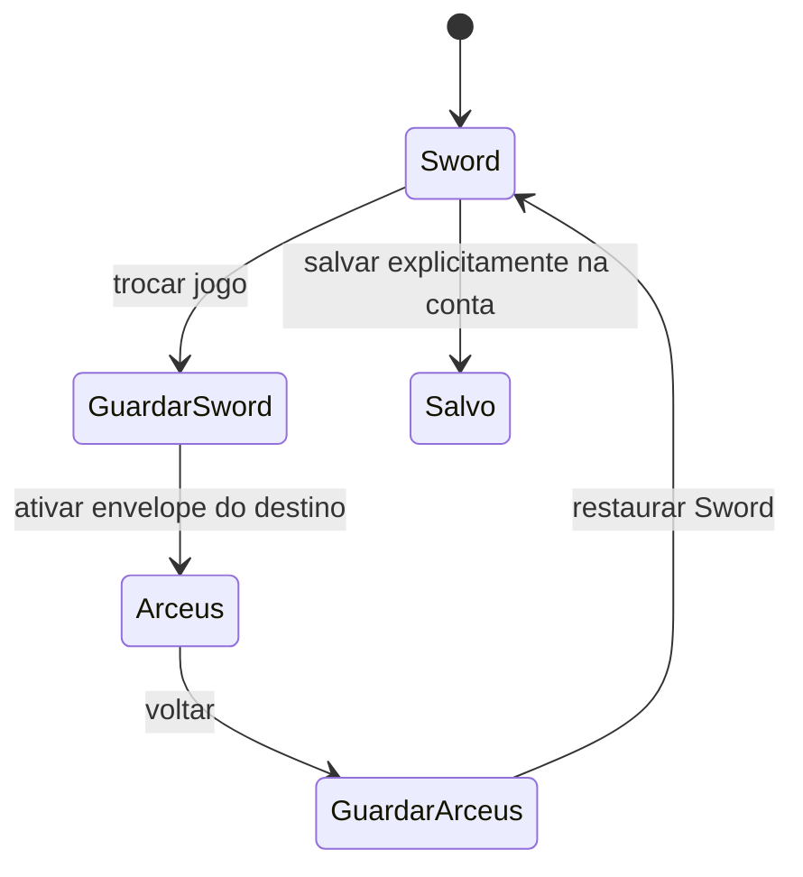

# Jornadas principais de uso — Pokétactics

30/10/2026 · checkout e62ce15 · análise heurística, sem pesquisa com usuários reais ou implementação.

Os fluxos abaixo descrevem o produto encontrado e as decisões do plano. “Atual” pode ser demonstrado por código; a coluna de evidência distingue execução real, simulação e trecho não executado. Contagem de interação exclui caracteres digitados, rolagem e tempo de leitura; cliques dependem do dispositivo. Os números são decomposição da tarefa e metas futuras, sem cronometragem nem percentual de ganho validado. Todo salvamento autenticado real deve ser validado na etapa de implementação com banco de teste.

## J1. Encontrar uma espécie, criar uma build e usá-la no time

- **Perfil:** iniciante, com apoio de recomendações; avançado ao experimentar movimentos.
- **Objetivo:** descobrir Lucario, entender o conjunto e salvar uma equipe com essa configuração.
- **Pré-condições:** Sword, base disponível, menos de seis membros; conta para persistência final.
- **Fluxo atual:** Pokédex → digitar nome → abrir ficha → Builds → editar campos → Adicionar à equipe no hero → abrir Construtor → sugerir/refazer golpes → salvar (ou entrar e voltar).
- **Etapas/interações:** depois de editar a build, transferência atual exige adicionar + navegar + até quatro escolhas repetidas e campos auxiliares. O gerador já transfere movimentos; a ficha adiciona só espécie.
- **Fricções:** UX-04 perde o Member; UX-05 não conserva edição ao consultar learnset; UX-16 perde recorte do catálogo. Termos técnicos têm explicação/fonte, portanto não se justifica um tour obrigatório.
- **Possíveis erros:** acreditar que o índice da build avaliada corresponde à equipe adicionada; salvar membro sem golpes; exceder seis; usar transformação como permanente.
- **Fluxo recomendado:** editar build → Adicionar esta build → feedback com Abrir construtor → revisar análise → salvar; com time cheio, escolher slot e confirmar/cancelar sem destruir antes.
- **Justificativa:** uma decisão estratégica já tomada não deve ser redigitada. A ação mantém o significado de espécie vs build e a liberdade de montar manualmente.
- **Validação:** IDs/ordem de movimentos, item/habilidade/nature iguais no editor e time; legalidade por jogo; nenhuma transferência de Mega; visitante transfere ao rascunho; login só para persistência. UX-04/05/06/07/08/16.
- **Evidência:** transferência real na UI com Lucario Sword: [8,89,347,370] → []; persistência autenticada não executada.

## J2. Escolher jogo, montar equipe manual e analisar cobertura

- **Perfil:** intermediário.
- **Objetivo:** montar até seis integrantes compatíveis e entender fraquezas compartilhadas.
- **Pré-condições:** jogo ativo, pool local disponível; montagem manual não limita progresso de campanha.
- **Fluxo atual:** selecionar jogo → abrir construtor → digitar filtro → abrir select → escolher espécie → editar/sugerir movimentos → repetir → ler índice/matriz e recomendações.
- **Etapas/interações:** por inclusão com nome conhecido há foco no input, digitação, abertura de outro select e escolha; a busca não exige confirmação prévia. Slots vazios e Adicionar Pokémon já focam o seletor.
- **Fricções:** UX-06 troca de controle; UX-07 forma temporária oferecida para inclusão; UX-08 campos compactados; UX-09 troca de membro destrutiva. Análise debounced existente deve ser mantida.
- **Possíveis erros:** selecionar Mega, achar que habilidade vale em Arceus/Z-A, confundir base stats com efetivos; os dois últimos têm regras/avisos corretos a preservar.
- **Fluxo recomendado:** digitar no seletor e confirmar sugestão → configurar slots estáveis → análise indica a revisão atual → selecionar membro e Substituir sem removê-lo antes.
- **Justificativa:** reduzir ações repetidas e impedir promessas inválidas, preservando montagem manual, seleção de movimentos e validação do servidor.
- **Validação:** teclado/mouse/toque selecionam; forme equipe em três jogos; imunidades/defesas continuam iguais ao motor; atualização não usa resultado antigo; cancelamento mantém configuração. Não criar proibição de espécies repetidas no modo manual. UX-06/07/08/09.
- **Evidência:** seleção Luc e Mega X e sugestão reais; reordenação ausente por código, sem proposta de drag-and-drop.

## J3. Gerar equipe, compreender resultado e aproveitar no construtor

- **Perfil:** iniciante/intermediário.
- **Objetivo:** obter combinação válida para as restrições escolhidas e ajustá-la.
- **Pré-condições:** campanha, escolha consciente de DLC e progresso; snapshot atual sem etapas de movimentos verificadas.
- **Fluxo atual:** abrir gerador → definir estilo/etapa/tamanho/DLC/obrigatórios/proibidos → Gerar → erro de insuficiência no modo estrito → localizar Ignorar progresso → gerar → ler seis cards/métricas/avisos → Ajustar no construtor → editar/salvar.
- **Etapas/interações:** recuperação atual: ler erro, procurar checkbox, marcar e submeter outra vez; tentativa de tamanho menor pode repetir erro sem resolver lacuna. O opt-in nunca deve ser automático.
- **Fricções:** UX-14 diagnóstico genérico; UX-13 obrigatório acima do tamanho; UX-15 etapa salva não hidratada; UX-12 resultado persiste após critérios mudarem.
- **Possíveis erros:** interpretar ausência de etapa como indisponibilidade do Pokémon; abrir seis enquanto o campo pede um; proibir membro e aceitar resultado que ainda o contém.
- **Fluxo recomendado:** inicializar etapa adequada → preflight explica contradições → gerar snapshot de critérios → erro factual com opt-in explícito → gerar novamente → resultado identificado como atual → transferir movimentos → substituir integrante pelo fluxo contextual.
- **Justificativa:** resultado tem que corresponder ao pedido visível e a recuperação deve apontar a restrição real, sem prometer dados que não existem.
- **Validação:** estrito não inventa obtenção; opt-in não ativa DLC; alterar qualquer parâmetro torna transferência indisponível até novo resultado; respostas atrasadas são descartadas; six→one gera realmente um na nova rodada; variante preserva determinismo. UX-09/12/13/14/15.
- **Evidência:** geração real Z-A sem opt-in falhou com 400; com opt-in gerou seis; depois tamanho um manteve seis cards. Transferência do gerador existe por código; salvar final não reexecutado.

## J4. Investigar fraquezas, comparar alternativas e substituir

- **Perfil:** intermediário/avançado.
- **Objetivo:** encontrar alternativa a um membro para reduzir uma fraqueza compartilhada sem destruir a configuração atual.
- **Pré-condições:** time configurado e análise disponível, candidato escolhido pelo usuário; não há recomendador novo de substitutos.
- **Fluxo atual:** ler matriz → procurar espécie na Pokédex/analisador → ficha → Comparar → escolher outros painéis → consultar movimentos → voltar ao construtor → remover membro → adicionar candidato ao fim → refazer build.
- **Etapas/interações:** pelo menos três contextos de ferramenta, com nova seleção no comparador e remoção antes da escolha final; sem medição de tempo.
- **Fricções:** memória da composição, retorno de catálogo (UX-16), seletor (UX-06), remoção antecipada (UX-09). Comparador já tem tabelas para até quatro e aviso do radar de dois.
- **Possíveis erros:** escolher BST maior como vencedor absoluto, comparar disponibilidade de outro jogo, confundir defesa por tipos com efeitos de habilidades; textos existentes limitam essas interpretações.
- **Fluxo recomendado:** investigar usando ferramentas existentes → conservar time por jogo → voltar ao mesmo slot → Substituir → selecionar build/candidato → cancelar ou confirmar → revisar a análise resultante. Não forçar recomendações automáticas ou vencedor universal.
- **Justificativa:** segurança para experimentar vale mais que reduzir toda a investigação a um clique.
- **Validação:** outros cinco integrantes intactos; slot preservado; métricas recalculadas; cancelar mantém build antiga; comparador segue disponível e não mistura dados. UX-01/06/09/16.
- **Evidência:** comparador com três e troca Sword/Arceus/Z-A reais; troca contextual proposta, ainda não implementada; persistência específica de painéis em links sucessivos é HYP-02.

## J5. Abrir equipe salva, editar e atualizar o registro correto

- **Perfil:** usuário recorrente.
- **Objetivo:** retomar estratégia salva, modificar, recarregar e atualizar o mesmo registro; criar outra quando quiser.
- **Pré-condições:** equipe de propriedade do usuário em conta de teste, /me saudável.
- **Fluxo atual:** Minhas equipes → Abrir no construtor → nome/configuração → atualização; se recarregar, mantém membros mas perde editTeamId/nome. Se voltar à coleção e Nova equipe sem reload, a identidade antiga continua.
- **Etapas/interações:** abrir+editar+salvar é curto e correto sem interrupção. O problema aparece na retomada e na diferença entre criar/atualizar, não na quantidade de cliques feliz.
- **Fricções:** UX-02 envelope incompleto; UX-03 “Nova” com PATCH; UX-18 erro de refresh parece logout; UX-11 exclusão sem proteção.
- **Possíveis erros:** cópia acidental após reload ou sobrescrita acidental após Nova equipe; apagar registro pelo ícone.
- **Fluxo recomendado:** abrir → envelope completo vinculado à conta → editar com indicador pendente → reload restaura → atualizar mesmo ID. Nova equipe inicia ação distinta e trata trabalho pendente antes de mudar identidade; excluir confirma nome antes de DELETE.
- **Justificativa:** a intenção de atualização/criação deve sobreviver a interrupções e ficar verificável antes de gravar.
- **Validação:** POST/PATCH por intenção; troca de conta não reaproveita ID privado; cancelamento preserva; registro ausente vira cópia local identificada; erro pós-gravação não induz novo POST. UX-01/02/03/11/18.
- **Evidência:** UI com /me/equipe simulados confirmou estados Atualizar→reload→Salvar e Nova mantendo Atualizar. Backend real de CRUD não testado nesta rodada.

## J6. Abrir ficha e continuar o catálogo ou favoritos

- **Perfil:** avançado/recorrente.
- **Objetivo:** examinar vários candidatos do mesmo recorte sem repetir filtro/ordem/página.
- **Pré-condições:** catálogo com busca/filtros; conta se origem é favoritos; página válida.
- **Fluxo atual:** definir recorte → abrir card → consultar abas/formas/evolução → link Voltar à Pokédex → lista padrão. Voltar do navegador pode ter comportamento diferente por cache; não foi validado universalmente.
- **Etapas/interações:** refazer cada filtro e avançar novamente até a página anterior após cada visita; não há contagem fixa para todos os recortes.
- **Fricções:** UX-16 estado local e origem perdida; UX-17 vazio de movimentos confunde filtro com fonte ausente.
- **Possíveis erros:** pensar que favorito desapareceu ao cair no catálogo, interpretar filtro vazio como ausência de learnset, sair do site por back cego.
- **Fluxo recomendado:** recorte em URL validada → ficha com origem local → voltar ao recorte e card; aba de movimentos distingue filtro vazio de base vazia e permite limpar.
- **Justificativa:** reduzir memória e preservar o contexto de comparação de candidatos.
- **Validação:** busca, todos os filtros, sort, page e game sobrevivem à ficha/reload; favoritos retorna a favoritos; URL malformada usa defaults; foco restaurado. UX-06/16/17.
- **Evidência:** Luc→Lucario→link Voltar resultou em busca vazia; query de movimento sem match mostrou justificativa de lacuna apesar de 79 registros.

## J7. Consultar outro jogo e retomar trabalho

- **Perfil:** recorrente e explorador de formas.
- **Objetivo:** ver como dados mudam por jogo e continuar a composição original.
- **Pré-condições:** rascunho não vazio; outro jogo compatível selecionável globalmente ou por forma relacionada.
- **Fluxo atual:** selecionar outro jogo → draft limpo/editTeamId nulo → dados novos → voltar ao jogo anterior → equipe vazia. A página de formas pode escolher automaticamente game na URL da forma.
- **Etapas/interações:** duas trocas podem custar reconstrução de até seis Members, além de nome e intenção de edição.
- **Fricções:** UX-01 descarte implícito; UX-15 etapa não acompanha preferências; UX-12 descarta requisição apenas quando game muda, não em outros critérios.
- **Possíveis erros:** supor que o time foi filtrado temporariamente quando foi apagado; restaurar golpes do jogo errado numa futura solução ingênua.
- **Fluxo recomendado:** guardar envelope da origem → ativar contexto destino com seu envelope/etapa → explicar preservação local → retornar à origem e restaurar integralmente.
- **Justificativa:** disponibilidade e legalidade são contextos separados, mas a consulta não precisa destruir um rascunho.
- **Validação:** três jogos, formas e perfil; storage falha sem travar; nenhuma conversão de movimentos; resposta de jogo anterior não atualiza a tela nova. UX-01/02/12/15.
- **Evidência:** Sword→Arceus→Sword real resultou em zero slots; preservação proposta ainda depende de implementação.

## J8. Importar uma equipe e recuperar de erro

- **Perfil:** recorrente/avançado que usa exportação JSON.
- **Objetivo:** abrir arquivo válido sem perder rascunho existente e corrigir erros no contexto.
- **Pré-condições:** JSON version:1 exportado, até 64 KB e jogo correspondente; rascunho local pode existir.
- **Fluxo atual:** Importar → escolher arquivo ou colar → Validar e importar → parse/servidor → erro toast fora do diálogo ou substituição do rascunho ao sucesso → salvar na conta.
- **Etapas/interações:** duas formas de entrada já existem; não substituir por upload externo. Erro atual exige perceber aviso obscurecido antes de corrigir.
- **Fricções:** UX-10 erro técnico e fora do modal; UX-02 metadados de rascunho; UX-01 troca de jogo pode apagar trabalho.
- **Possíveis erros:** JSON parcial, arquivo grande, outra versão/jogo, nome inválido, array vazio, movimento ilegal, offline. São cenários de teste; apenas parse “{” foi reproduzido ao vivo nesta rodada.
- **Fluxo recomendado:** entrada → validação estrutural clara no modal → legalidade server-side → se substituir trabalho pendente, confirmar → abrir envelope novo → salvar explicitamente. Divergência de jogo permite cancelar/abrir no contexto correto preservando origem.
- **Justificativa:** diagnóstico deve ficar no mesmo plano de interação e falha não deve modificar rascunho.
- **Validação:** erro anunciado dentro, texto preservado, time intacto; corrigir e importar seis reais; exportar mantém Member/ordem; Escape devolve foco; confirmar só quando substituir trabalho. UX-01/02/10/18.
- **Evidência:** captura desta rodada mostra modal sem diagnóstico e toast por trás do backdrop; export/import completo estava em testes anteriores, não reexecutado aqui.

## J9. Entrar, favoritar e recuperar coleção após falha

- **Perfil:** visitante que vira recorrente.
- **Objetivo:** guardar favoritos/equipes/builds e reconhecer se a conta está disponível.
- **Pré-condições:** autenticação para conta real em rodada de implementação; neste audit apenas código e /me simulado.
- **Fluxo atual:** favorito como visitante → toast com Entrar → perfil → login/cadastro → navegação manual de volta; favoritos carregados por refresh. Qualquer falha em /me define personal=null e mostra convite de cadastro.
- **Etapas/interações:** o login não reexecuta automaticamente favorito; não foi decidido fazê-lo sem análise de intenção. Prioridade é não apresentar indisponibilidade como inexistência da conta.
- **Fricções:** UX-18 estados colapsados; UX-11 exclusão sem confirmação; erros de campos autenticados são hipótese HYP-05.
- **Possíveis erros:** rede, 401 real, resposta antiga após logout, gravação concluída com refresh falho; SMTP pode estar ausente e reset deve comunicar isso honestamente.
- **Fluxo recomendado:** loading próprio → autenticado/visitante confirmado/erro distintos → repetir consulta com dados da mesma sessão claramente desatualizados quando seguro → confirmar salvamentos pela resposta de mutação → atualizar coleção. Logout limpa dados privados e vínculo local conforme política.
- **Justificativa:** usuário precisa distinguir “não entrou” de “não foi possível consultar”.
- **Validação:** /me503 mostra falha com retry; 401 limpa conta; reconexão recupera coleção; nenhuma duplicação por repetição de POST; duas contas isoladas. UX-02/11/18. Retorno pós-login automatizado permanece fora do escopo até validação específica.
- **Evidência:** /me503 simulado mostrou “Sua coleção começa com uma conta”; login/cadastro/save reais e entrega de recuperação não foram testados. Roteiro de recuperação de senha foi rejeitado pela revisão automática e retirado.

## J10. Gerar relatório estratégico e mudar o contexto

- **Perfil:** iniciante/intermediário.
- **Objetivo:** entender uma espécie, analisar outra e repetir uma tentativa sem perder anotação.
- **Pré-condições:** análise por regras disponível, LLM desativado; histórico só com opt-in.
- **Fluxo atual:** selecionar → anotação opcional → gerar → relatório no chat → mudar espécie → relatório anterior permanece sem cabeçalho de origem; nova falha limpa input e só mostra mensagem técnica.
- **Etapas/interações:** o texto já nomeia a espécie e explica template; não há interpretação de pergunta livre e isso não é defeito.
- **Fricções:** UX-20 associação entre contexto atual/anterior e retry; UX-06 seleção em dois controles; histórico pode exigir reload (HYP-03).
- **Possíveis erros:** atribuir relatório de Lucario a Pikachu; duplicar mensagem do usuário ao tentar recuperar; resposta de seleção antiga; histórico de jogo diferente sem metadados.
- **Fluxo recomendado:** snapshot de contexto e anotação → relatório com cabeçalho espécie/jogo → seletor identificado como próxima análise → falha preserva anotação e retry usa snapshot explícito → histórico contextual quando presente.
- **Justificativa:** associação clara é necessária mesmo num sistema determinístico; não depende de LLM.
- **Validação:** Lucario/Sword continua com origem explícita após escolher Pikachu; offline/retry conserva anotação; game switch não aplica resposta antiga; legado sem contexto é marcado desconhecido. UX-06/18/20.
- **Evidência:** seleção Pikachu com relatório Lucario e input vazio após abort foram reproduzidos. Histórico autenticado foi inspecionado por código, não executado.

## J11. Consultar rankings e critérios antes de confiar numa recomendação

- **Perfil:** iniciante e avançado.
- **Objetivo:** compreender o que significa uma classe/índice e verificar procedência.
- **Pré-condições:** catálogo disponível; fontes/health podem falhar separadamente.
- **Fluxo atual:** Tier Lists → ler aviso da estimativa → filtrar tipo/etapa/transformações → abrir ficha; aba comunitária explica insuficiência; Fontes reúne critérios/cobertura. Se health falhar, página mostra “Consultando...” e zero fontes apesar de sources poder funcionar.
- **Etapas/interações:** descoberta de /fontes já tem sidebar e rodapé; não criar seção nova de ajuda só por convenção.
- **Fricções:** UX-19 estado contraditório; UX-16 retorno da ficha; limite36 por classe é informado e não foi classificado como defeito sem tarefa real bloqueada.
- **Possíveis erros:** tratar índice de atributos como ranking competitivo, zero fontes de uma falha como ausência factual; avisos existentes devem permanecer.
- **Fluxo recomendado:** manter estimativa e limites → consulta independente de saúde/fontes → erro terminal com retry localizado → abrir fontes disponíveis mesmo se outro recurso falhou.
- **Justificativa:** transparência é parte da experiência estratégica; recuperação deve preservar evidência disponível.
- **Validação:** health503/sources200 mantém fontes; retry encerra loading; ranking comunitário não é fabricado; filtros continuam por jogo. UX-16/19.
- **Evidência:** rotas abertas nos três tamanhos; critérios/tiers inspecionados em código; health503 simulado reproduziu “Consultando...”.

## Critérios transversais de avaliação das jornadas

| Dimensão             | Iniciante                                 | Intermediário                                 | Avançado                                      | Recorrente                          |
| -------------------- | ----------------------------------------- | --------------------------------------------- | --------------------------------------------- | ----------------------------------- |
| Descoberta/início    | Próxima ação e limite em linguagem clara  | Funções de composição disponíveis no contexto | Acesso direto sem onboarding imposto          | Retomar rascunho e origem           |
| Interações           | Nenhuma decisão invisível de legalidade   | Evitar repetir seleção/configuração           | Teclado eficiente, slots e builds preservados | POST/PATCH e envelope previsíveis   |
| Resultados/feedback  | Distinguir ausência de dados de falha     | Cobertura/matriz com contexto do time         | Snapshot do critério e fonte                  | Estado salvo/pendente/sincronização |
| Correção/controle    | Erro no campo/modal e ação de recuperação | Cancelar substituição sem perder membro       | Experimentar sem reset silencioso             | Recuperar após reload/troca de jogo |
| Memória/continuidade | Reconhecer forma/jogo nos resultados      | Time não desaparece ao pesquisar              | Recorte/posição de retorno e Member íntegro   | Preferências por jogo respeitadas   |
| Concluir/retomar     | Salvar na conta com requisito claro       | Atualizar análise antes de decidir            | Reutilizar build sem redigitar                | Identidade da equipe preservada     |

## Revisão crítica e limites

Os fluxos recomendados preservam as decisões manuais úteis: opt-in de progresso, movimento, estilo, comparação, confirmação de substituição e salvamento explícito. Automatizar apenas transporte de informação já escolhida e restauração de contexto. Metas futuras: zero configuração perdida em transições especificadas; zero resultado transferível com critérios divergentes; erro sempre recuperável no contexto; zero DELETE antes de confirmação. Essas são aceitações de implementação, não métricas já alcançadas.

Não declarar conclusão das jornadas autenticadas com base nas fixtures. A rodada posterior deve executá-las num banco de teste e registrar limitações de leitor de tela/toque/SMTP. Nenhuma mudança funcional foi aplicada nesta entrega; as jornadas e o prompt estão aguardando revisão do usuário.
